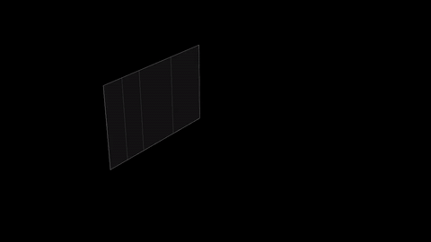
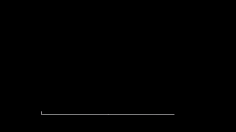
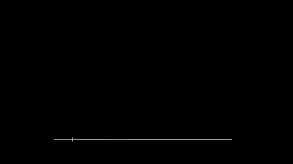
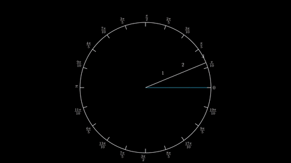
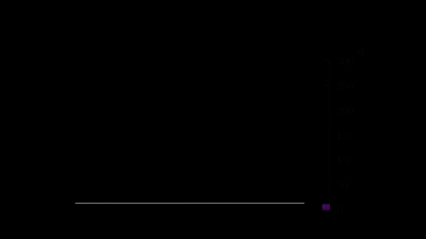

# manim-plots

Plotting for [Manim](https://www.manim.community/) that stays correct while you animate
it.

<p align="center">
  
  
</p>

manim-plots gives Manim scenes coordinate systems and data plots that are spelled and
behave like Manim's own — `mp.Axes`, `axis_config`, `ax.plot`, `get_graph_label`,
`.animate` — and keep working when the axes move, scale or change their range: every
curve, label and helper belongs to its axes and follows them on every frame. On top of
Manim's graphing helpers it adds what a plotting library needs: scales, tick locators
and formatters, legends, themes, error bars, bars, histograms, heatmaps, statistics
plots, vector fields, polar and 3D axes, and animations made for data.

- [Installation](#installation)
- [Quick start](#quick-start)
- [Tutorial](#tutorial)
- [Gallery](#gallery)
- [Documentation](#documentation)

## Installation

You need Python 3.12 or newer and Manim Community Edition 0.21 or 0.22 with its
[system dependencies](https://docs.manim.community/en/stable/installation.html),
LaTeX included (axis numbers and labels are typeset as in Manim). manim-plots draws
with Manim's Cairo renderer, the default.

manim-plots is not on PyPI yet. Install the release from GitHub:

```sh
pip install "git+https://github.com/sjcmdev/manim-plots@v0.1.0"
```

or, in a [uv](https://docs.astral.sh/uv/) project:

```sh
uv add "git+https://github.com/sjcmdev/manim-plots@v0.1.0"
```

## Quick start

Save this as `first_plot.py`:

```python
import numpy as np
from manim import BLUE, UL, Create, MathTex, Scene

import manim_plots as mp


class FirstPlot(Scene):
    def construct(self):
        ax = mp.Axes(
            x_range=(-4, 4, 1),
            y_range=(-2, 2, 1),
            axis_config={"include_numbers": True},
        )
        curve = ax.plot(np.sin, color=BLUE)
        label = ax.get_graph_label(curve, MathTex(r"\sin x"), x_val=2.5)
        self.play(Create(ax), Create(curve))
        self.add(label)
        self.play(ax.animate.scale(0.6).to_corner(UL))
        self.play(ax.animate.set_x_range((-8, 8)))
```

and render it as any Manim scene:

```sh
manim -pql first_plot.py FirstPlot
```

The curve and its label follow the axes when they move and when their range changes —
no `VGroup`, no updater, no `always_redraw`.

## Tutorial

Every example below is a complete scene; run it with `manim -pql file.py SceneName`.
The [gallery](#gallery) has longer ones.

### 1. Axes and plots

`mp.Axes` takes Manim's arguments — `x_range`, `y_range`, `x_length`, `y_length`,
`axis_config`, `x_axis_config`, `y_axis_config`, `tips` — and Manim's defaults. Plot a
function with `ax.plot`, data with `ax.line` or `ax.scatter`, a curve with
`ax.plot_parametric_curve`:

```python
import numpy as np
from manim import YELLOW, Create, FadeIn, Scene

import manim_plots as mp


class Plots(Scene):
    def construct(self):
        ax = mp.Axes(x_range=(0, 10, 1), y_range=(-2, 2, 1))
        wave = ax.plot(lambda x: np.sin(x) * np.exp(-x / 5))
        xs = np.linspace(0.5, 9.5, 10)
        data = ax.scatter(xs, np.cos(xs) / 2, color=YELLOW)
        loop = ax.plot_parametric_curve(
            lambda t: (5 + 2 * np.cos(t), np.sin(t)), t_range=(0, 2 * np.pi)
        )
        self.play(Create(ax), Create(wave), Create(loop), FadeIn(data))
```

Everything plotted on `ax` is bound to it. `ax.c2p(x, y)` and `ax.p2c(point)` convert
between data and scene coordinates, as in Manim. A pole such as `1 / x` splits the
curve instead of drawing a vertical line, and curves are clipped to the axes
(`clip=False` turns that off).

### 2. Styling the axes

Manim's `axis_config` keys keep their names. Each axis is also reachable as `ax.x` and
`ax.y`, and every part of it — line, ticks, numbers, grid — can be styled on its own:

```python
import numpy as np
from manim import RED, Scene

import manim_plots as mp


class Styled(Scene):
    def construct(self):
        ax = mp.Axes(
            x_range=(0, 10, 2),
            y_range=(0.1, 1000),
            y_scale="log",
            axis_config={"include_numbers": True},
            theme="origin",
        )
        ax.x.set_locator(mp.MultipleLocator(2), minor=mp.MultipleLocator(0.5))
        ax.x.set_grid("major", stroke_opacity=0.3)
        ax.y.set_tick_style("minor", length=0.08)
        self.add(ax, ax.plot(lambda x: 10 ** (x / 3), color=RED, label="10^(x/3)"))
        self.add(ax.legend("upper left"))
```

- **Scales:** `x_scale` / `y_scale` take `"linear"`, `"log"`, `"symlog"`, `"logit"` or
  a scale object (`mp.LogScale(base=2)`, `mp.FunctionScale(forward, inverse)`).
- **Ticks:** `ax.x.set_locator(...)` with `mp.MultipleLocator`, `mp.MaxNLocator`,
  `mp.FixedLocator`, `mp.LogLocator`, or any function `(lo, hi) -> values`.
- **Numbers:** `ax.x.set_formatter(...)` with `mp.DecimalFormatter`,
  `mp.PercentFormatter`, `mp.ScientificFormatter`, `mp.EngFormatter`, or a function.
- **Placement:** `ax.x.set_position("bottom")`, `ax.x.mirror()`, `frame="box"`,
  `ax.x.set_tick_style(direction=mp.TickDirection.OUT)`.
- **Themes:** `theme="origin"` on one axes, or `mp.set_theme("paper")` for all; the
  built-in themes are `manim`, `origin`, `base`, `paper` and `lab`.
- **Legend:** give artists a `label=` and call `ax.legend()`.

### 3. Animating the data

Ranges and function parameters animate with Manim's own `.animate`, or follow a
`ValueTracker` on every frame:

```python
import numpy as np
from manim import Scene, ValueTracker

import manim_plots as mp


class Animated(Scene):
    def construct(self):
        ax = mp.Axes(x_range=(-3, 3, 1), y_range=(-3, 3, 1))
        a = ValueTracker(1.0)
        # The keyword `a=` binds the function's parameter `a` to the tracker.
        wave = ax.plot(lambda x, a=1.0: a * np.sin(x), a=a)
        self.add(ax, wave)
        self.play(ax.animate.set_x_range((0, 10)))
        self.play(a.animate.set_value(2.5))
        self.play(wave.animate.set_parameters(a=0.5))
        self.play(ax.animate.scale(0.7).set_x_range((-6, 6)))
```

Ticks keep their identity while the range moves, so they slide instead of popping.
`Transform`, `always_redraw`, `Create`, `FadeOut` and the rest of Manim work on every
plot as on any mobject.

### 4. Manim's helpers, bound to the axes

Manim's graphing helpers keep their names and arguments, follow the axes, and accept a
`ValueTracker` wherever a value can change:

```python
import numpy as np
from manim import BLUE, Scene, ValueTracker

import manim_plots as mp


class Calculus(Scene):
    def construct(self):
        ax = mp.Axes(x_range=(-1, 5, 1), y_range=(-1, 6, 1))
        graph = ax.plot(lambda x: x**2 / 4 + 0.5, color=BLUE)
        x, dx = ValueTracker(1.0), ValueTracker(2.0)
        secant = ax.get_secant_slope_group(x, graph, dx=dx)
        area = ax.get_area(graph, x_range=(0, 4), opacity=0.3)
        self.add(ax, area, graph, secant)
        self.play(dx.animate.set_value(0))  # the secant becomes the tangent
        self.play(x.animate.set_value(3.5))
```

Also available: `get_vertical_line`, `get_horizontal_line`, `get_lines_to_point`,
`get_T_label`, `get_tangent_line`, `slope_of_tangent`, `get_riemann_rectangles`,
`plot_derivative_graph`, `plot_antiderivative_graph`, `get_vector_field`,
`get_stream_lines`, `plot_polar_graph`, `plot_implicit_curve`, `plot_surface` and more,
plus matplotlib-style `axhline`, `axvspan`, `fill_between`, `annotate` and `crosshair`.

### 5. Data plots

The plotting methods follow matplotlib's names and arguments:

| Kind | Methods |
|---|---|
| Lines and points | `plot`, `line`, `scatter`, `step`, `stairs`, `stem` (3D), `errorbar` |
| Bars | `bar`, `barh`, `grouped_bar`, `bar_label`, `bar3d` |
| Distributions | `hist`, `hist2d`, `hist3d`, `stackplot`, `boxplot`, `violinplot`, `mp.PieChart` |
| Grids | `imshow`, `pcolormesh`, `hexbin`, `contour`, `contourf`, `colorbar` |
| More axes | `twinx`, `twiny`, `secondary_xaxis`, `inset`, `mp.PolarAxes`, `mp.NumberPlane` |
| 3D | `mp.ThreeDAxes` with `plot_surface`, `plot_wireframe`, `plot_trisurf`, `voxels`, `plot_isosurface`, `plot_slice` |

Data plots take new data with `.animate.set_data(...)`, so a bar chart or a histogram
moves to its next values in one `self.play`.

### 6. Animations made for plots

Besides Manim's own animations, `mp` has animations that know what a plot is. Each
entrance is also its exit with `reverse=True`:

| Animation | What it does |
|---|---|
| `DrawAxes`, `BuildAxes` | draw the axes, or build them part by part |
| `TraceCurve`, `ShowPoints`, `Morph` | trace a curve at a steady pace, pop points in an order, morph one curve into another |
| `GrowBars`, `SortBars`, `HighlightBar`, `GrowStack` | grow bars from their base, sort them, dim all but one |
| `AppendData` | append data live, widening the axes to keep it |
| `GrowRegion`, `SweepRegion`, `GrowRiemann`, `RefineRiemann` | grow areas and Riemann sums, refine them to a smaller `dx` |
| `GrowErrorBars`, `RevealAnnotation`, `RevealLegend`, `FillColorbar` | bring decorations in by their meaning |
| `RevealCells`, `RevealContours`, `RebinHistogram` | reveal heatmaps and contours, rebin a histogram |
| `GrowBoxPlot`, `UnfoldViolin`, `SweepPie`, `ExplodePie` | statistics plots |
| `SweepPolar`, `SweepSurface`, `RevealWireframe`, `StackVoxels`, `SweepIsovalue` | polar and 3D construction |

```python
import numpy as np
from manim import Scene

import manim_plots as mp


class Bars(Scene):
    def construct(self):
        ax = mp.Axes(y_range=(0, 10, 2))
        bars = ax.bar(["a", "b", "c", "d"], [3, 7, 5, 2])
        self.add(ax)
        self.play(mp.GrowBars(bars, lag_ratio=0.2))
        self.play(bars.animate.set_data(x=["a", "b", "c", "d"], height=[6, 2, 8, 4]))
        self.play(mp.SortBars(bars, reverse=True))
        self.play(mp.GrowBars(bars, reverse=True))
```

### 7. Three dimensions

Use a `ThreeDScene` and `mp.ThreeDAxes`. `frame="box"` draws matplotlib's box, whose
panes change sides as the camera turns; `ax.view(elev, azim)` gives the camera
matplotlib's angles:

```python
import numpy as np
from manim import ThreeDScene

import manim_plots as mp


class Surface(ThreeDScene):
    def construct(self):
        ax = mp.ThreeDAxes(
            x_range=(-3, 3, 1), y_range=(-3, 3, 1), z_range=(-1, 1, 0.5),
            x_length=5, y_length=5, z_length=3, frame="box",
        )  # fmt: skip
        self.set_camera_orientation(**ax.view(25, -55))
        surface = ax.plot_surface(
            lambda u, v: np.sin(u) * np.cos(v), (-3, 3), (-3, 3), colorscale="viridis"
        )
        self.add(ax)
        self.play(mp.SweepSurface(surface))
        self.move_camera(**ax.view(40, 60), run_time=3)
```

### Coming from Manim

Most Manim plotting code runs after one change: build the axes with `mp.Axes` instead
of `Axes` (and `mp.NumberPlane`, `mp.ThreeDAxes`, `mp.PolarPlane` likewise). Then drop
the `VGroup`s and updaters that kept graphs on their axes. Where manim-plots differs
from Manim, it is because Manim's behaviour is a defect — a curve drawn outside its
axes, a vertical line at a pole, a graph left behind — and each difference is listed in
[Differences from Manim](https://github.com/sjcmdev/manim-plots/blob/main/docs/site/differences.rst).

## Gallery

Each example is one scene in [`examples/`](https://github.com/sjcmdev/manim-plots/tree/main/examples), next to its video. Click a
picture for the code.

<table>
<tr>
<td width="50%"><a href="https://github.com/sjcmdev/manim-plots/blob/main/examples/01_first_plot.py"></a><br><b>First plot</b> — axes, a curve and its label; all follow the axes. <a href="https://github.com/sjcmdev/manim-plots/blob/main/examples/01_first_plot.mp4">video</a></td>
<td width="50%"><a href="https://github.com/sjcmdev/manim-plots/blob/main/examples/02_axes_styling.py"></a><br><b>Axes styling</b> — position, locators, tick direction, grid, mirror, one call at a time. <a href="https://github.com/sjcmdev/manim-plots/blob/main/examples/02_axes_styling.mp4">video</a></td>
</tr>
<tr>
<td><a href="https://github.com/sjcmdev/manim-plots/blob/main/examples/03_legend_and_styles.py"></a><br><b>Legend and styles</b> — colour cycle, dashes, marker shapes, legend. <a href="https://github.com/sjcmdev/manim-plots/blob/main/examples/03_legend_and_styles.mp4">video</a></td>
<td><a href="https://github.com/sjcmdev/manim-plots/blob/main/examples/04_animate_data.py"></a><br><b>Animating data</b> — ranges and parameters with <code>.animate</code> and trackers. <a href="https://github.com/sjcmdev/manim-plots/blob/main/examples/04_animate_data.mp4">video</a></td>
</tr>
<tr>
<td><a href="https://github.com/sjcmdev/manim-plots/blob/main/examples/05_tangent_and_secant.py"></a><br><b>Tangent and secant</b> — a secant closes into the tangent and slides. <a href="https://github.com/sjcmdev/manim-plots/blob/main/examples/05_tangent_and_secant.mp4">video</a></td>
<td><a href="https://github.com/sjcmdev/manim-plots/blob/main/examples/06_riemann_sums.py"></a><br><b>Riemann sums</b> — rectangles rise, refine and give way to the area. <a href="https://github.com/sjcmdev/manim-plots/blob/main/examples/06_riemann_sums.mp4">video</a></td>
</tr>
<tr>
<td><a href="https://github.com/sjcmdev/manim-plots/blob/main/examples/07_error_bars.py"></a><br><b>Error bars</b> — measurements, a fit, and a new run moved in. <a href="https://github.com/sjcmdev/manim-plots/blob/main/examples/07_error_bars.mp4">video</a></td>
<td><a href="https://github.com/sjcmdev/manim-plots/blob/main/examples/08_log_scale.py"></a><br><b>Log scale</b> — power laws on log-log axes, ranges growing by decades. <a href="https://github.com/sjcmdev/manim-plots/blob/main/examples/08_log_scale.mp4">video</a></td>
</tr>
<tr>
<td><a href="https://github.com/sjcmdev/manim-plots/blob/main/examples/09_twin_axes.py"></a><br><b>Twin axes</b> — two quantities, two y axes, one shared x range. <a href="https://github.com/sjcmdev/manim-plots/blob/main/examples/09_twin_axes.mp4">video</a></td>
<td><a href="https://github.com/sjcmdev/manim-plots/blob/main/examples/10_polar.py"></a><br><b>Polar axes</b> — a rose curve whose amplitude follows a tracker. <a href="https://github.com/sjcmdev/manim-plots/blob/main/examples/10_polar.mp4">video</a></td>
</tr>
<tr>
<td><a href="https://github.com/sjcmdev/manim-plots/blob/main/examples/11_vector_field.py"></a><br><b>Vector field</b> — arrows, dots carried by the flow, stream lines. <a href="https://github.com/sjcmdev/manim-plots/blob/main/examples/11_vector_field.mp4">video</a></td>
<td><a href="https://github.com/sjcmdev/manim-plots/blob/main/examples/12_bar_chart.py"></a><br><b>Bar chart race</b> — bars grow, take new values and sort themselves. <a href="https://github.com/sjcmdev/manim-plots/blob/main/examples/12_bar_chart.mp4">video</a></td>
</tr>
<tr>
<td><a href="https://github.com/sjcmdev/manim-plots/blob/main/examples/13_histogram.py"></a><br><b>Histogram</b> — coloured by count, following a moving sample, rebinned. <a href="https://github.com/sjcmdev/manim-plots/blob/main/examples/13_histogram.mp4">video</a></td>
<td><a href="https://github.com/sjcmdev/manim-plots/blob/main/examples/14_heatmap.py"></a><br><b>Heatmap</b> — cells revealed, a colorbar, contour lines on top. <a href="https://github.com/sjcmdev/manim-plots/blob/main/examples/14_heatmap.mp4">video</a></td>
</tr>
<tr>
<td><a href="https://github.com/sjcmdev/manim-plots/blob/main/examples/15_statistics.py"></a><br><b>Statistics</b> — box and violin plots, a pie chart with an exploded wedge. <a href="https://github.com/sjcmdev/manim-plots/blob/main/examples/15_statistics.mp4">video</a></td>
<td><a href="https://github.com/sjcmdev/manim-plots/blob/main/examples/16_surface_3d.py"></a><br><b>Surface in 3D</b> — swept in on box axes, seen from all around. <a href="https://github.com/sjcmdev/manim-plots/blob/main/examples/16_surface_3d.mp4">video</a></td>
</tr>
<tr>
<td><a href="https://github.com/sjcmdev/manim-plots/blob/main/examples/17_histogram_3d.py"></a><br><b>3D histogram</b> — columns grown from a 2D sample under a turning camera. <a href="https://github.com/sjcmdev/manim-plots/blob/main/examples/17_histogram_3d.mp4">video</a></td>
<td><a href="https://github.com/sjcmdev/manim-plots/blob/main/examples/18_live_data.py"></a><br><b>Live data</b> — points appended live while the axes widen. <a href="https://github.com/sjcmdev/manim-plots/blob/main/examples/18_live_data.mp4">video</a></td>
</tr>
</table>

To render them all again: `uv run python tools/examples.py` (needs `ffmpeg` on `PATH`
for the GIFs).

## Documentation

- [Coming from Manim](https://github.com/sjcmdev/manim-plots/blob/main/docs/site/coming-from-manim.rst) — what keeps Manim's names and
  what to change in ported code.
- [Differences from Manim](https://github.com/sjcmdev/manim-plots/blob/main/docs/site/differences.rst) — every place the behaviour
  differs, and why.
- [Animations](https://github.com/sjcmdev/manim-plots/blob/main/docs/site/animations.rst) and the
  [picture gallery](https://github.com/sjcmdev/manim-plots/blob/main/docs/site/gallery.rst) with the code of each picture.
- [API reference](https://github.com/sjcmdev/manim-plots/blob/main/docs/site/api.rst). Build the whole site locally with
  `uv run --group docs sphinx-build -b html docs/site docs/site/_build/html`.
- [Changelog](https://github.com/sjcmdev/manim-plots/blob/main/CHANGELOG.md).

## Development

```sh
uv sync                         # create the environment
uv run pytest                   # run the test suite
uv run python tools/check.py    # every check, on both supported Manim versions
```

See [CONTRIBUTING.md](https://github.com/sjcmdev/manim-plots/blob/main/CONTRIBUTING.md) for the conventions.

## Licence

[MIT](https://github.com/sjcmdev/manim-plots/blob/main/LICENSE)
