Gallery
=======

These 60 reviewed pictures come from the visual tests. Each example is independent:
save its code as ``gallery.py`` and render its named Scene with Manim, for example:

.. code-block:: text

   manim -ql --renderer cairo gallery.py SineOnDefaultAxes

The still pictures use 854 by 480 pixels. Animation sheets show successive frames
from left to right, then top to bottom, at 6 frames per second and 427 by 240 pixels
per frame, including the final state. Rendering the Scene produces the animation;
the test harness arranges its frames into the sheet shown here.

The two gap examples filter the expected ManimPlotsWarning about a split path.
Other examples leave warnings enabled.

Sine on default axes
--------------------

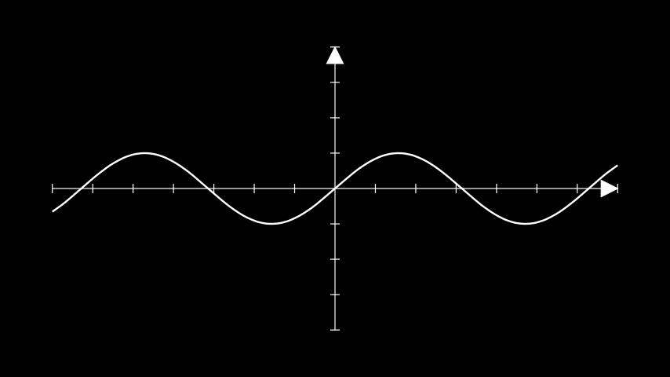

   A sine on the default axes. The curve is clipped to the viewport.

.. code-block:: python

   import numpy as np
   from manim import Scene

   import manim_plots as mp

   class SineOnDefaultAxes(Scene):
       def construct(self):
           ax = mp.Axes()
           self.add(ax, ax.plot(np.sin))

A pole on offset axes
---------------------

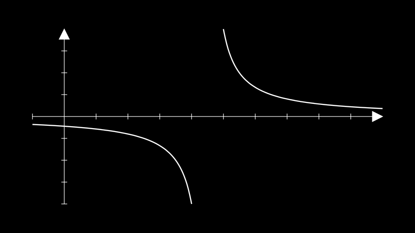

   The two sides of the pole stay separate and are clipped at the viewport.

.. code-block:: python

   import warnings
   from manim import Scene

   import manim_plots as mp

   class PoleOnOffsetAxes(Scene):
       def construct(self):
           with warnings.catch_warnings():
               warnings.filterwarnings(
                   "ignore",
                   message="source is empty or contains invalid samples or a pole;.*",
                   category=mp.ManimPlotsWarning,
               )
               ax = mp.Axes(x_range=(-1, 10, 1), y_range=(-2, 2, 0.5))
               self.add(ax, ax.plot(lambda x: 1 / (x - 4.5)))

Numbers on default axes
-----------------------

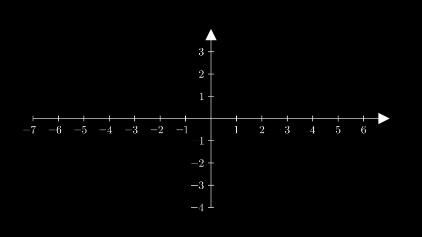

   Numbers use Manim's default positions and font size. The tick and number under each
   tip are omitted.

.. code-block:: python

   from manim import Scene

   import manim_plots as mp

   class NumbersOnDefaultAxes(Scene):
       def construct(self):
           self.add(mp.Axes(axis_config={"include_numbers": True}))

Even steps and quarters
-----------------------

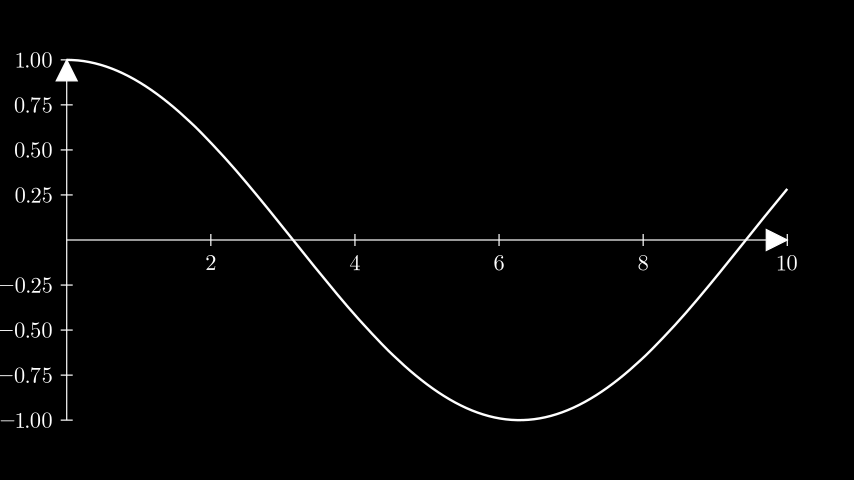

   A cosine with x ticks every 2 and y ticks every 0.25.

.. code-block:: python

   import numpy as np
   from manim import Scene

   import manim_plots as mp

   class EvenStepsAndQuarters(Scene):
       def construct(self):
           ax = mp.Axes(
               x_range=(0, 10, 2),
               y_range=(-1, 1, 0.25),
               axis_config={"include_numbers": True},
           )
           self.add(ax, ax.plot(lambda x: np.cos(x / 2)))

Manim LogBase ranges
--------------------

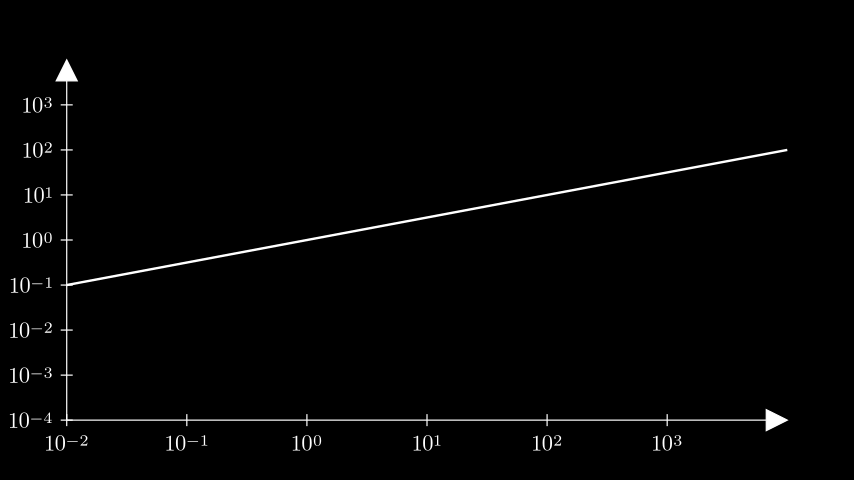

   Manim's LogBase in axis_config applies to both axes here. Its ranges are exponents,
   and its labels are powers of ten.

.. code-block:: python

   import numpy as np
   from manim import LogBase, Scene

   import manim_plots as mp

   class LogBaseAxis(Scene):
       def construct(self):
           ax = mp.Axes(
               x_range=(-2, 4, 1),
               axis_config={"scaling": LogBase(), "include_numbers": True},
           )
           self.add(ax, ax.plot(np.sqrt))

A number plane
--------------

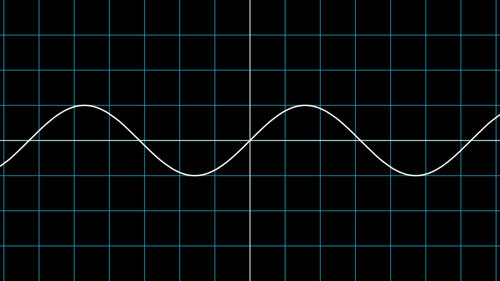

   The default NumberPlane background and faded grid, with a sine.

.. code-block:: python

   import numpy as np
   from manim import Scene

   import manim_plots as mp

   class NumberPlaneSine(Scene):
       def construct(self):
           plane = mp.NumberPlane()
           self.add(plane, plane.plot(np.sin))

A log scale with minor ticks
----------------------------

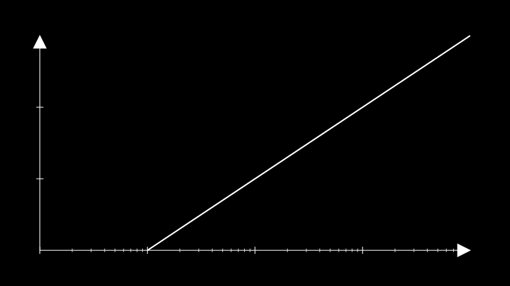

   The library's x_scale="log" takes data ranges. log10 is straight on these axes, with
   minor ticks between decades.

.. code-block:: python

   import numpy as np
   from manim import Scene

   import manim_plots as mp

   class LogScaleWithMinorTicks(Scene):
       def construct(self):
           ax = mp.Axes(x_range=(0.1, 1000), y_range=(0, 3, 1), x_scale="log")
           self.add(ax, ax.plot(np.log10, x_range=(0.1, 1000)))

Border axes, mirror and grid
----------------------------

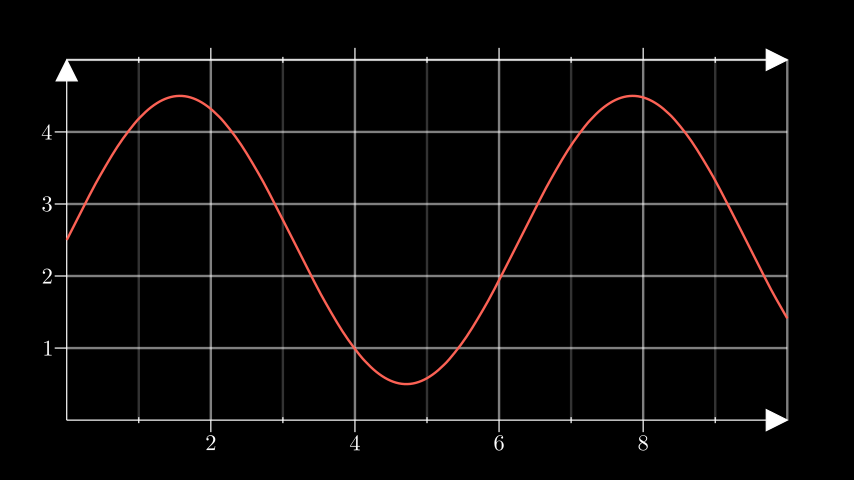

   Outward ticks, a mirrored top axis, and separate major and minor grids.

.. code-block:: python

   import numpy as np
   from manim import RED, Scene

   import manim_plots as mp
   from manim_plots import MultipleLocator
   from manim_plots.mobjects.axis import TickDirection

   class BorderAxes(Scene):
       def construct(self):
           ax = mp.Axes(
               x_range=(0, 10, 2), y_range=(0, 5, 1), axis_config={"include_numbers": True}
           )
           ax.x.set_position("bottom")
           ax.y.set_position("left")
           ax.x.set_locator(MultipleLocator(2), minor=MultipleLocator(1))
           for axis in (ax.x, ax.y):
               axis.set_tick_style(direction=TickDirection.OUT)
               axis.set_grid("major", stroke_opacity=0.5)
           ax.x.set_grid("minor", stroke_opacity=0.2)
           top = ax.x.mirror()
           self.add(ax, top, ax.plot(lambda x: 2.5 + 2 * np.sin(x), color=RED))

Rotated labels on a dense axis
------------------------------

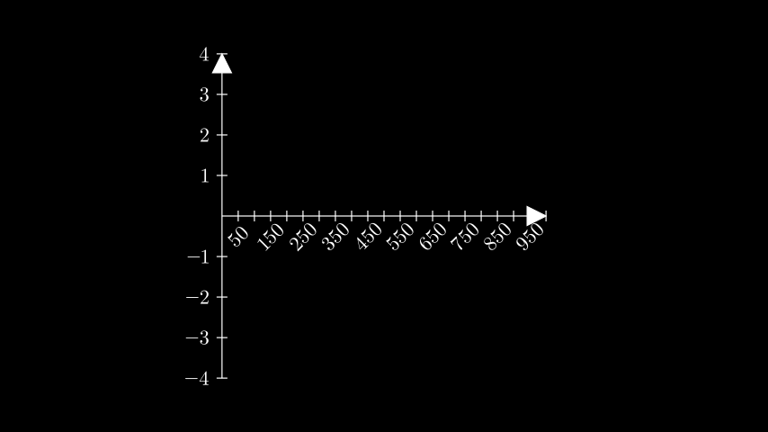

   The rotate overlap policy turns the numbers by 45 degrees and hides those that still
   collide.

.. code-block:: python

   from manim import Scene

   import manim_plots as mp

   class RotatedLabels(Scene):
       def construct(self):
           ax = mp.Axes(
               x_range=(0, 1000, 50), x_length=6, axis_config={"include_numbers": True}
           )
           ax.x.set_label_style(overlap="rotate")
           self.add(ax)

An aspect lock
--------------

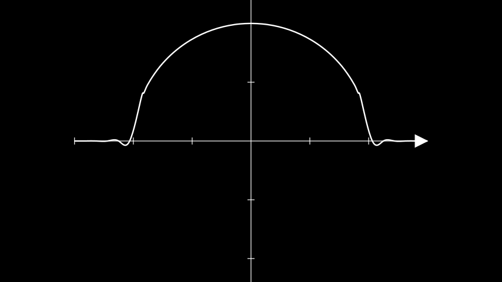

   Equal data units have equal scene lengths. This sampled upper semicircle uses the
   test's smoothing and zero-valued tails.

.. code-block:: python

   import numpy as np
   from manim import Scene

   import manim_plots as mp

   class AspectLock(Scene):
       def construct(self):
           ax = mp.Axes(x_range=(-3, 3, 1), y_range=(-3, 3, 1), x_length=10, aspect=1.0)
           self.add(ax, ax.plot(lambda x: np.sqrt(np.maximum(4 - x**2, 0))))

An array line with a gap
------------------------

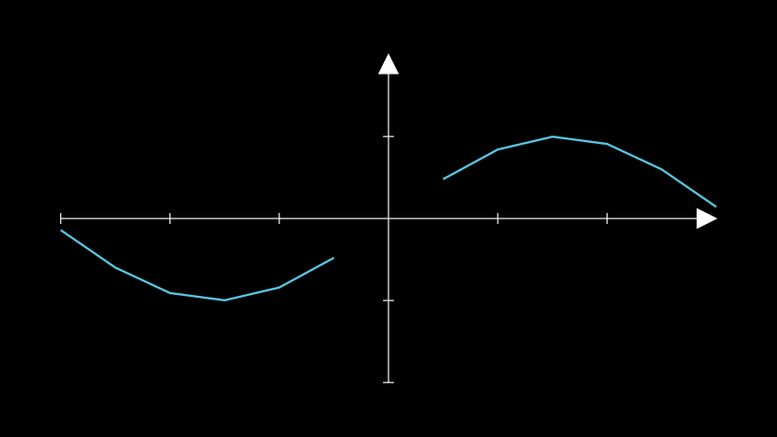

   A NaN sample splits an array line. The data is retained unchanged.

.. code-block:: python

   import warnings
   import numpy as np
   from manim import BLUE, Scene

   import manim_plots as mp

   class LineWithGap(Scene):
       def construct(self):
           with warnings.catch_warnings():
               warnings.filterwarnings(
                   "ignore",
                   message="source is empty or contains invalid samples or a pole;.*",
                   category=mp.ManimPlotsWarning,
               )
               ax = mp.Axes(x_range=(-3, 3, 1), y_range=(-2, 2, 1))
               xs = np.linspace(-3, 3, 13)
               ys = np.sin(xs)
               ys[6] = np.nan
               self.add(ax, ax.line(xs, ys, color=BLUE))

Scatter with a custom marker
----------------------------

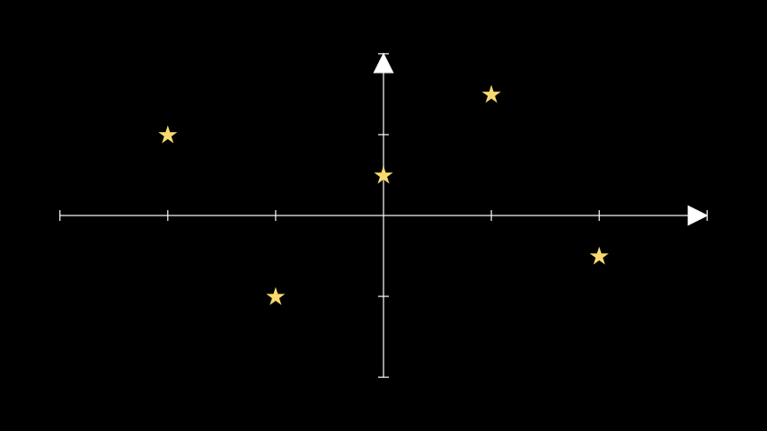

   A native Star supplies each marker's shape and style. The point outside the viewport
   is hidden.

.. code-block:: python

   from manim import Scene, Star, YELLOW

   import manim_plots as mp

   class ScatterWithStars(Scene):
       def construct(self):
           ax = mp.Axes(x_range=(-3, 3, 1), y_range=(-2, 2, 1))
           marker = Star(outer_radius=0.12, color=YELLOW, fill_opacity=1)
           self.add(
               ax,
               ax.scatter([-2, -1, 0, 1, 2, 5], [1, -1, 0.5, 1.5, -0.5, 0], marker=marker),
           )

A clipped parametric spiral
---------------------------

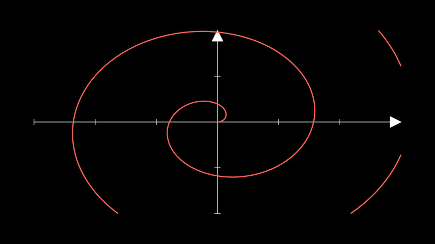

   The spiral is sampled in parameter order and clipped where it leaves the axes.

.. code-block:: python

   import numpy as np
   from manim import RED, Scene

   import manim_plots as mp

   class ClippedSpiral(Scene):
       def construct(self):
           ax = mp.Axes(x_range=(-3, 3, 1), y_range=(-2, 2, 1))
           spiral = ax.plot_parametric_curve(
               lambda t: (0.25 * t * np.cos(t), 0.25 * t * np.sin(t)),
               t_range=(0, 14),
               color=RED,
           )
           self.add(ax, spiral)

A line graph with vertex dots
-----------------------------

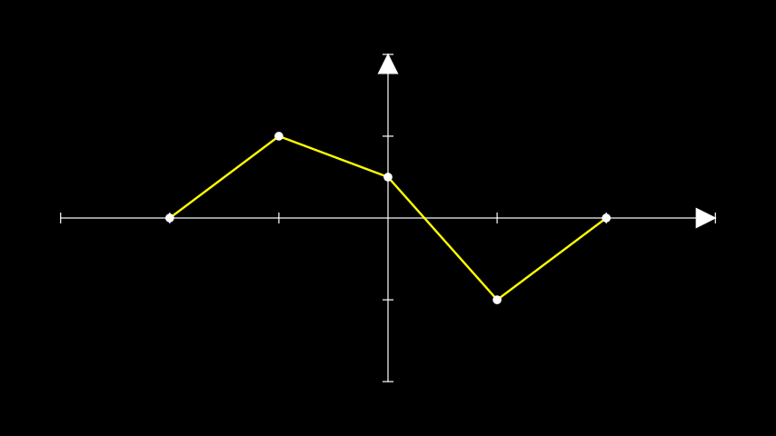

   Manim's plot_line_graph spelling and yellow default, with vertex dots.

.. code-block:: python

   from manim import Scene

   import manim_plots as mp

   class LineGraph(Scene):
       def construct(self):
           ax = mp.Axes(x_range=(-3, 3, 1), y_range=(-2, 2, 1))
           self.add(ax, ax.plot_line_graph([-2, -1, 0, 1, 2], [0, 1, 0.5, -1, 0]))

Animating a range
-----------------

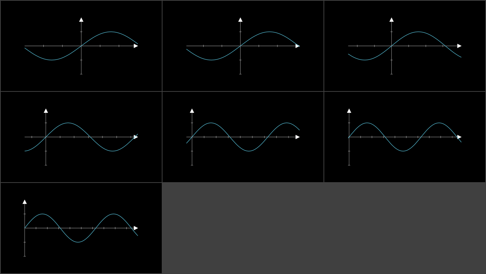

   The ticks, axis placement and sine update for every frame's range.

.. code-block:: python

   import numpy as np
   from manim import BLUE, Scene

   import manim_plots as mp

   class AnimatedRange(Scene):
       def construct(self):
           ax = mp.Axes(x_range=(-3, 3, 1), y_range=(-2, 2, 1), x_length=10, y_length=5)
           self.add(ax, ax.plot(np.sin, color=BLUE))
           self.play(ax.animate.set_x_range((0, 10)), run_time=1)

Creating axes and a curve
-------------------------

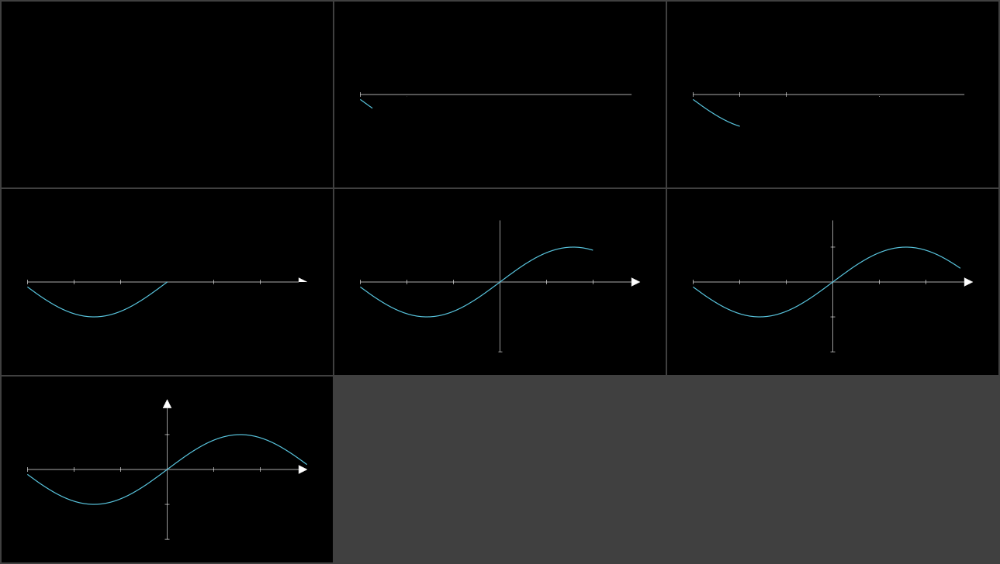

   Native Create draws the axes and curve together. The hidden frame takes its own lag
   slot on the axes.

.. code-block:: python

   import numpy as np
   from manim import BLUE, Create, Scene

   import manim_plots as mp

   class CreateAxesAndPlot(Scene):
       def construct(self):
           ax = mp.Axes(x_range=(-3, 3, 1), y_range=(-2, 2, 1))
           self.play(Create(ax), Create(ax.plot(np.sin, color=BLUE)), run_time=1)

The colour cycle and a legend
-----------------------------

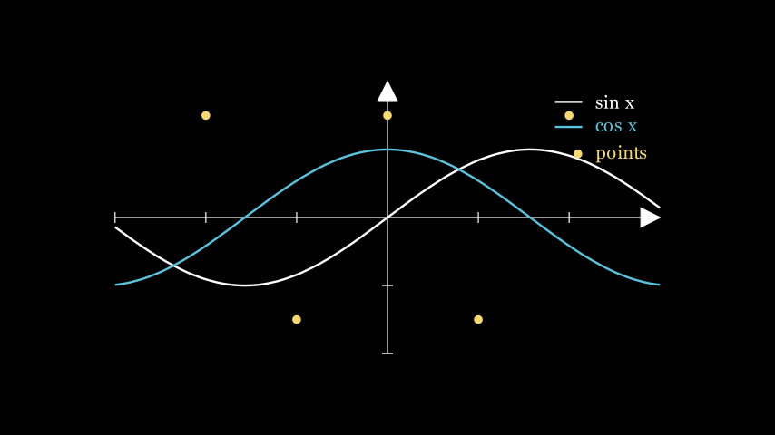

   Two curves and a scatter take white, blue and yellow. The legend uses their labels
   and styles.

.. code-block:: python

   import numpy as np
   from manim import Scene

   import manim_plots as mp

   class CycleAndLegend(Scene):
       def construct(self):
           ax = mp.Axes(x_range=(-3, 3, 1), y_range=(-2, 2, 1), x_length=10, y_length=5)
           sin = ax.plot(np.sin, label="sin x")
           cos = ax.plot(np.cos, label="cos x")
           dots = ax.scatter(
               [-2, -1, 0, 1, 2], [1.5, -1.5, 1.5, -1.5, 1.5], label="points"
           )
           self.add(ax, sin, cos, dots, ax.legend())

Line styles
-----------

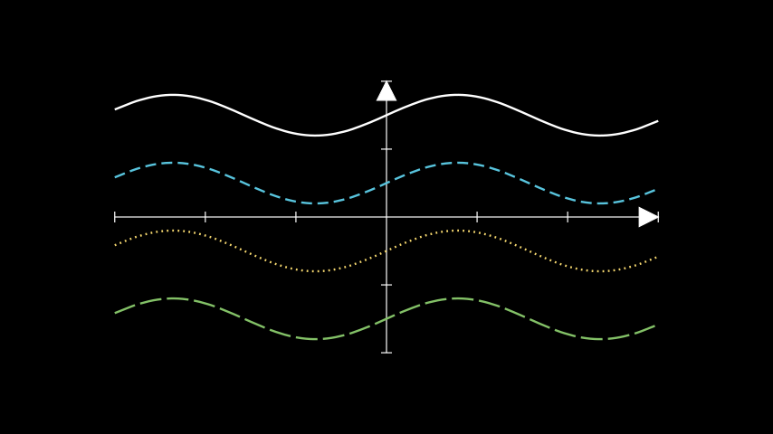

   Solid, dashed, dotted and a custom dash pattern, from top to bottom. Dash lengths are
   in scene units.

.. code-block:: python

   import numpy as np
   from manim import Scene

   import manim_plots as mp

   class LineStyles(Scene):
       def construct(self):
           ax = mp.Axes(x_range=(-3, 3, 1), y_range=(-2, 2, 1), x_length=10, y_length=5)
           self.add(ax)
           for k, style in enumerate(
               [mp.LineStyle.SOLID, mp.LineStyle.DASHED, mp.LineStyle.DOTTED]
           ):
               self.add(
                   ax.plot(lambda x, k=k: 1.5 - k + 0.3 * np.sin(2 * x), line_style=style)
               )
           self.add(ax.plot(lambda x: -1.5 + 0.3 * np.sin(2 * x), dash=(0.4, 0.1)))

Named markers
-------------

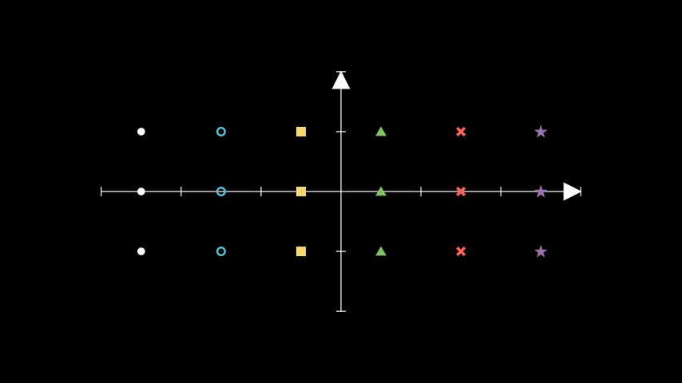

   Left to right: dot, circle, square, triangle, cross and star, with three points for
   each.

.. code-block:: python

   from manim import Scene

   import manim_plots as mp

   class NamedMarkers(Scene):
       def construct(self):
           ax = mp.Axes(x_range=(-3, 3, 1), y_range=(-2, 2, 1), x_length=10, y_length=5)
           self.add(ax)
           for k, marker in enumerate(mp.Marker):
               x = -2.5 + k
               self.add(ax.scatter([x, x, x], [1, 0, -1], marker=marker))

Tracing in data order
---------------------

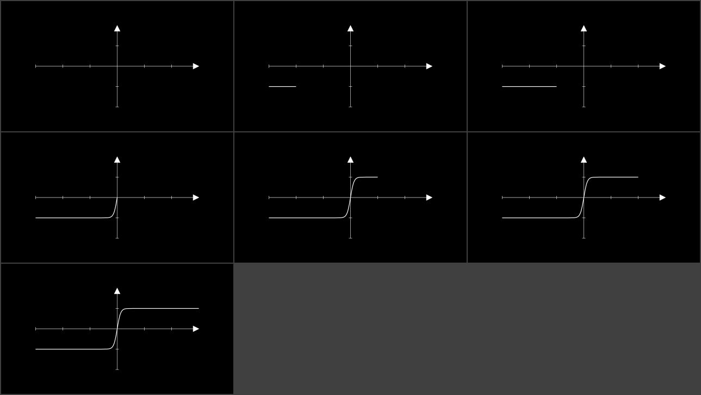

   With a linear rate function, TraceCurve advances steadily in x even near the densely
   sampled bend.

.. code-block:: python

   import numpy as np
   from manim import Scene, linear

   import manim_plots as mp

   class TraceCurveFrames(Scene):
       def construct(self):
           ax = mp.Axes(x_range=(-3, 3, 1), y_range=(-2, 2, 1), x_length=10, y_length=5)
           curve = ax.plot(lambda x: np.tanh(8 * x))
           self.add(ax)
           self.play(mp.TraceCurve(curve, rate_func=linear), run_time=1)

Morphing paths
--------------

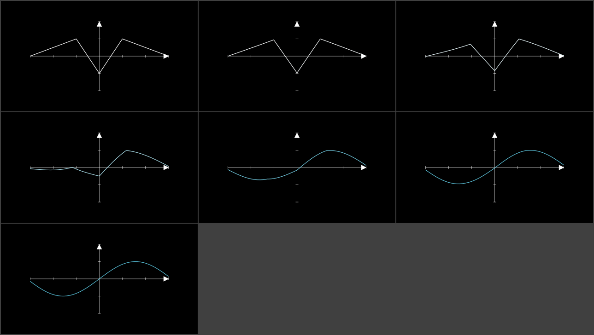

   Morph resamples a five-point zigzag and a fifty-point sine onto a shared arc-length
   lattice.

.. code-block:: python

   import numpy as np
   from manim import Scene

   import manim_plots as mp

   class MorphFrames(Scene):
       def construct(self):
           ax = mp.Axes(x_range=(-3, 3, 1), y_range=(-2, 2, 1), x_length=10, y_length=5)
           zigzag = ax.line([-3, -1, 0, 1, 3], [0, 1, -1, 1, 0])
           xs = np.linspace(-3, 3, 50)
           sine = ax.line(xs, np.sin(xs))
           self.add(ax, zigzag)
           self.play(mp.Morph(zigzag, sine), run_time=1)

Bound helpers: lines and tangents
---------------------------------

A secant slope group at x = 1 with dx = 1.5, and an orange tangent at x = -2.

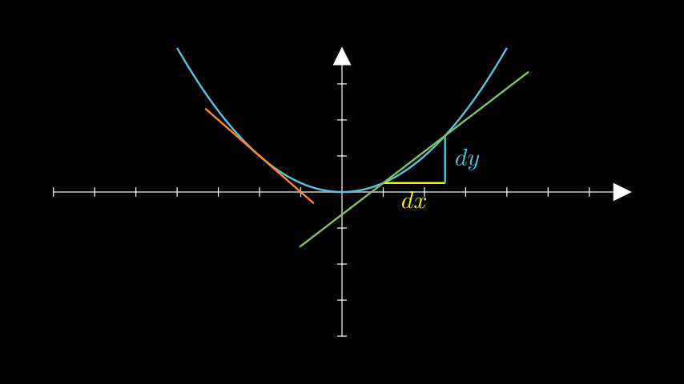

   manim-plots

.. code-block:: python

   from manim import BLUE, ORANGE, Scene
   import manim_plots as mp

   def quarter(x):
       return x**2 / 4

   class SecantAndTangent(Scene):
       def construct(self):
           ax = mp.Axes()
           graph = ax.plot(quarter, color=BLUE)
           secant = ax.get_secant_slope_group(
               1, graph, dx=1.5, dx_label="dx", dy_label="dy", secant_line_length=6
           )
           tangent = ax.get_tangent_line(-2, graph, length=3, color=ORANGE)
           self.add(ax, graph, secant, tangent)

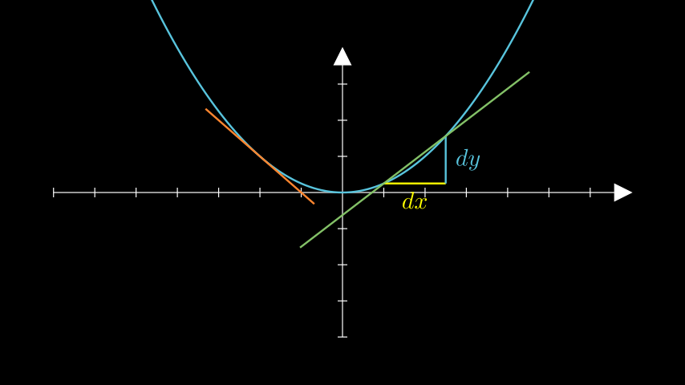

   plain Manim

.. code-block:: python

   import numpy as np
   from manim import BLUE, ORANGE, Axes, Line, Scene

   def quarter(x):
       return x**2 / 4

   class SecantAndTangentManim(Scene):
       def construct(self):
           ax = Axes()
           graph = ax.plot(quarter, color=BLUE)
           point = ax.c2p(-2, quarter(-2))
           step = ax.c2p(-1, quarter(-2) - 1) - ax.c2p(-2, quarter(-2))
           step = 1.5 * step / np.linalg.norm(step)
           secant = ax.get_secant_slope_group(
               1, graph, dx=1.5, dx_label="dx", dy_label="dy", secant_line_length=6
           )
           parts = Line(point - step, point + step, color=ORANGE)
           self.add(ax, graph, secant, parts)

Bound helpers: regions
----------------------

Manim's Riemann example: right samples on (-4, -3), a yellow signed sum on (-1.5, 1.5)
whose middle dips below the axis, and an area under the parabola from 2 to 3 (task 17).

   manim-plots

.. code-block:: python

   from manim import BLUE, BLUE_B, DARK_BLUE, TEAL, YELLOW, Scene
   import manim_plots as mp

   def parabola(x):
       return 0.5 * x**2 - 0.5

   class AreaAndRiemannRectangles(Scene):
       def construct(self):
           ax = mp.Axes(y_range=(-2, 10, 1))
           graph = ax.plot(parabola, color=BLUE)
           rectangles = ax.get_riemann_rectangles(
               graph,
               x_range=(-4, -3),
               dx=0.25,
               color=(TEAL, BLUE_B, DARK_BLUE),
               input_sample_type="right",
           )
           rectangles2 = ax.get_riemann_rectangles(
               graph, x_range=(-1.5, 1.5), dx=0.15, color=YELLOW
           )
           area = ax.get_area(graph, x_range=(2, 3))
           self.add(ax, graph, rectangles, rectangles2, area)

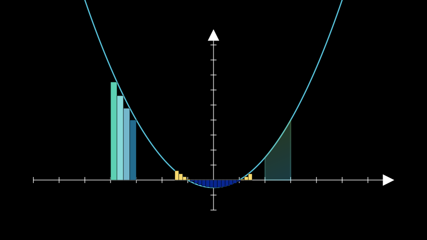

   plain Manim

.. code-block:: python

   from manim import BLUE, BLUE_B, DARK_BLUE, TEAL, YELLOW, Axes, Scene

   def parabola(x):
       return 0.5 * x**2 - 0.5

   class AreaAndRiemannRectanglesManim(Scene):
       def construct(self):
           ax = Axes(y_range=[-2, 10])
           graph = ax.plot(parabola, color=BLUE)
           rectangles = ax.get_riemann_rectangles(
               graph,
               x_range=[-4, -3],
               dx=0.25,
               color=(TEAL, BLUE_B, DARK_BLUE),
               input_sample_type="right",
           )
           rectangles2 = ax.get_riemann_rectangles(
               graph, x_range=[-1.5, 1.5], dx=0.15, color=YELLOW
           )
           area = ax.get_area(graph, x_range=(2, 3))
           self.add(ax, graph, rectangles, rectangles2, area)

Bound helpers: 2D helpers
-------------------------

A damped wave, a shaded interval, a band, and the peak annotated.

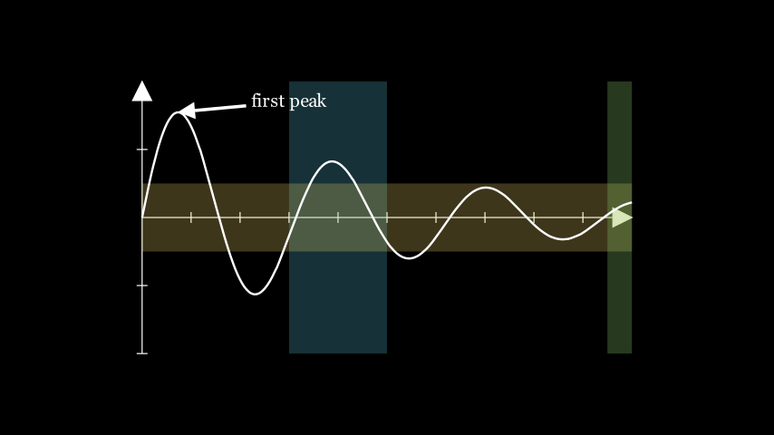

   manim-plots

.. code-block:: python

   import numpy as np
   from manim import Scene
   import manim_plots as mp

   def axes() -> mp.Axes:
       return mp.Axes(x_range=(0, 10, 1), y_range=(-2, 2, 1), x_length=9, y_length=5)

   class AnnotationSpansAndFillBetweenx(Scene):
       def construct(self):
           ax = axes()
           wave = ax.plot(lambda x: 1.8 * np.exp(-x / 5) * np.sin(2 * x))
           span = ax.axvspan(3, 5)
           band = ax.axhspan(-0.5, 0.5)
           side = ax.fill_betweenx(np.linspace(-2, 2, 41), 9.5, 10)
           note = ax.annotate("first peak", (0.73, 1.55), (3, 1.7))
           self.add(ax, span, band, side, wave, note)

Error bars
----------

``ax.errorbar`` with asymmetric y errors and symmetric x errors, caps 0.1 long, in yellow.

.. figure:: ../../tests/visual/baselines/test_artist_pictures/test_errorbars_in_x_and_y.png
   :alt: Error bars - manim-plots
   :width: 100%

   manim-plots

.. code-block:: python

   from typing import Any
   import numpy as np
   from manim import YELLOW, Scene
   import manim_plots as mp

   RANGES: dict[str, Any] = {"x_range": (-3, 3, 1), "y_range": (-2, 2, 1)}
   ERR_X = np.array([-2.0, -1.0, 0.0, 1.0, 2.0])
   ERR_Y = np.array([0.5, 1.2, 0.8, -0.4, 0.3])
   YERR = np.array([[0.2, 0.3, 0.2, 0.4, 0.3], [0.4, 0.3, 0.5, 0.2, 0.3]])
   XERR = 0.25

   class ErrorbarsInXAndY(Scene):
       def construct(self):
           ax = mp.Axes(**RANGES)
           errors = ax.errorbar(ERR_X, ERR_Y, yerr=YERR, xerr=XERR, color=YELLOW)
           self.add(ax, errors)

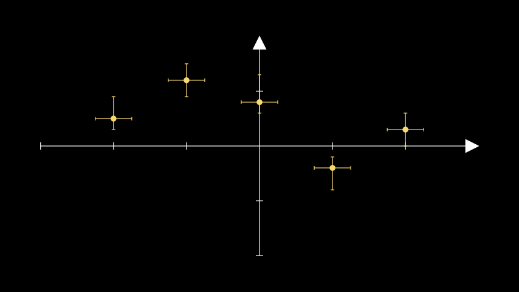

   plain Manim

.. code-block:: python

   from typing import Any
   import numpy as np
   from manim import (
       DOWN,
       LEFT,
       RIGHT,
       UP,
       YELLOW,
       Axes,
       Dot,
       Line,
       Scene,
       VGroup,
       VMobject,
   )

   RANGES: dict[str, Any] = {"x_range": (-3, 3, 1), "y_range": (-2, 2, 1)}
   ERR_X = np.array([-2.0, -1.0, 0.0, 1.0, 2.0])
   ERR_Y = np.array([0.5, 1.2, 0.8, -0.4, 0.3])
   YERR = np.array([[0.2, 0.3, 0.2, 0.4, 0.3], [0.4, 0.3, 0.5, 0.2, 0.3]])
   XERR = 0.25

   class ErrorbarsInXAndYManim(Scene):
       def construct(self):
           ax = Axes(**RANGES)
           parts: list[VMobject] = []
           for i, (x, y) in enumerate(zip(ERR_X, ERR_Y, strict=True)):
               lo, hi = (YERR[0, i], YERR[1, i])
               parts.append(Line(ax.c2p(x, y - lo), ax.c2p(x, y + hi), stroke_width=2))
               parts.append(Line(ax.c2p(x - XERR, y), ax.c2p(x + XERR, y), stroke_width=2))
               for end in (ax.c2p(x, y - lo), ax.c2p(x, y + hi)):
                   parts.append(
                       Line(end + 0.05 * LEFT, end + 0.05 * RIGHT, stroke_width=2)
                   )
               for end in (ax.c2p(x - XERR, y), ax.c2p(x + XERR, y)):
                   parts.append(Line(end + 0.05 * DOWN, end + 0.05 * UP, stroke_width=2))
               parts.append(Dot(ax.c2p(x, y)))
           set_color = VGroup(*parts).set_color(YELLOW)
           self.add(ax, set_color)

Twin and top axes
-----------------

A framed plot with an independent top axis from ``twiny``, taking the place of the top
mirror: time below, distance above.

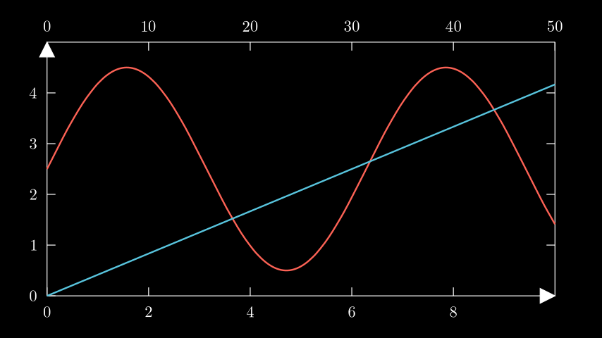

   manim-plots

.. code-block:: python

   from typing import Any
   import numpy as np
   from manim import BLUE, RED, Scene
   import manim_plots as mp

   NUMBERS: dict[str, Any] = {"include_numbers": True}

   class TopAxisTwiny(Scene):
       def construct(self):
           ax = mp.Axes(x_range=(0, 10, 2), y_range=(0, 5, 1), axis_config=NUMBERS)
           ax.x.set_position("bottom")
           ax.y.set_position("left")
           ax.x.mirror()
           ax.y.mirror()
           distance = ax.twiny(x_range=(0, 50, 10), x_axis_config=NUMBERS)
           curve = ax.plot(lambda t: 2.5 + 2 * np.sin(t), color=RED)
           curve2 = distance.plot(lambda d: d / 12, color=BLUE)
           self.add(ax, curve, curve2)

A spectrum in nanometres with electronvolts on a secondary top axis, decreasing from
left to right.

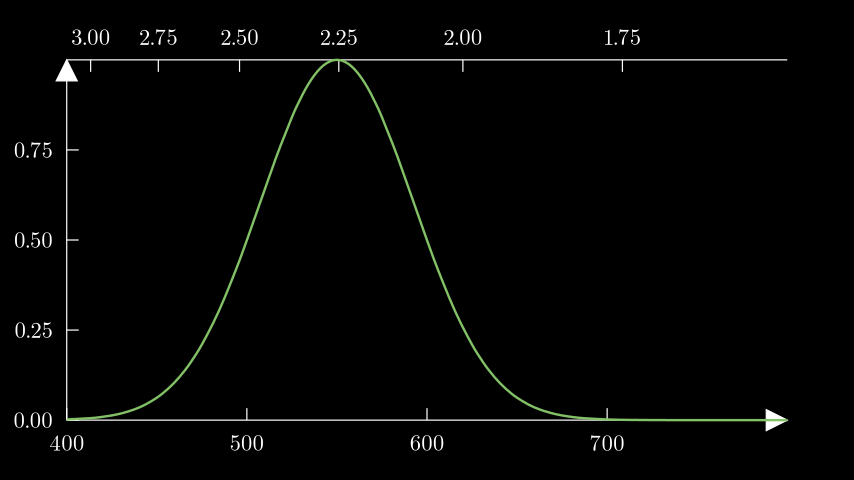

   manim-plots

.. code-block:: python

   from typing import Any
   import numpy as np
   from manim import GREEN, Scene
   import manim_plots as mp
   from manim_plots import MultipleLocator

   NUMBERS: dict[str, Any] = {"include_numbers": True}

   class SecondaryAxis(Scene):
       def construct(self):
           ax = mp.Axes(x_range=(400, 800, 100), y_range=(0, 1, 0.25), axis_config=NUMBERS)
           ax.x.set_position("bottom")
           ax.y.set_position("left")
           energy = ax.secondary_xaxis(
               "top", functions=(lambda nm: 1239.84198 / nm, lambda ev: 1239.84198 / ev)
           )
           energy.set_locator(MultipleLocator(0.25))
           line = ax.plot(lambda nm: np.exp(-(((nm - 550) / 60) ** 2)), color=GREEN)
           self.add(ax, line)

Themes
------

The paper theme: black and white, inward ticks, and cycling dashes and markers.

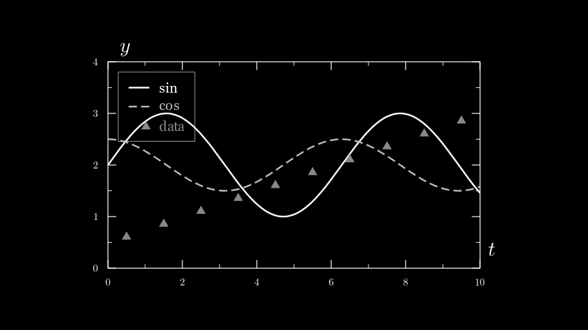

   manim-plots

.. code-block:: python

   import numpy as np
   from manim import Scene
   import manim_plots as mp

   class ThemePaper(Scene):
       def construct(self):
           ax = mp.Axes(
               x_range=(0, 10, 2),
               y_range=(0, 4, 1),
               x_length=9,
               y_length=5,
               axis_config={"include_numbers": True, "font_size": 24},
               theme="paper",
           )
           xs = np.linspace(0.5, 9.5, 10)
           curve = ax.plot(lambda x: 2 + np.sin(x), label="sin")
           curve2 = ax.plot(lambda x: 2 + np.cos(x) / 2, label="cos")
           dots = ax.scatter(xs, 0.5 + xs / 4, label="data")
           labels = ax.get_axis_labels("t", "y")
           legend = ax.legend()
           self.add(ax, curve, curve2, dots, labels, legend)

Fields and flow
---------------

An arrow field of a swirl on the default plane, coloured by norm; each arrow starts at
its grid point (Manim centres it there).

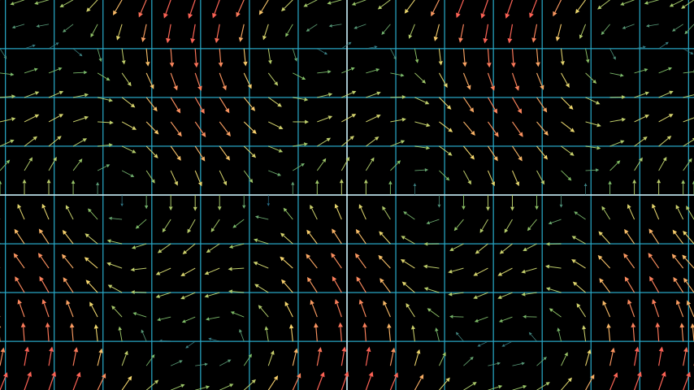

   manim-plots

.. code-block:: python

   import numpy as np
   from manim import Scene
   import manim_plots as mp

   def swirl(p):
       x, y = (p[0], p[1])
       return np.array([np.sin(y), np.cos(x) - 0.3 * y, 0.0])

   class VectorField(Scene):
       def construct(self):
           plane = mp.NumberPlane()
           field = plane.get_vector_field(swirl)
           self.add(plane, field)

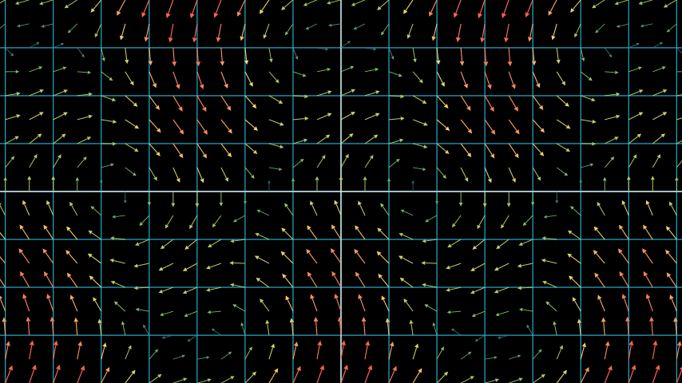

   plain Manim

.. code-block:: python

   import numpy as np
   from manim import ArrowVectorField, NumberPlane, Scene

   def swirl(p):
       x, y = (p[0], p[1])
       return np.array([np.sin(y), np.cos(x) - 0.3 * y, 0.0])

   class VectorFieldManim(Scene):
       def construct(self):
           parts = NumberPlane()
           parts2 = ArrowVectorField(swirl)
           self.add(parts, parts2)

Stream lines of the same swirl, integrated with RK4 and clipped to the plane.

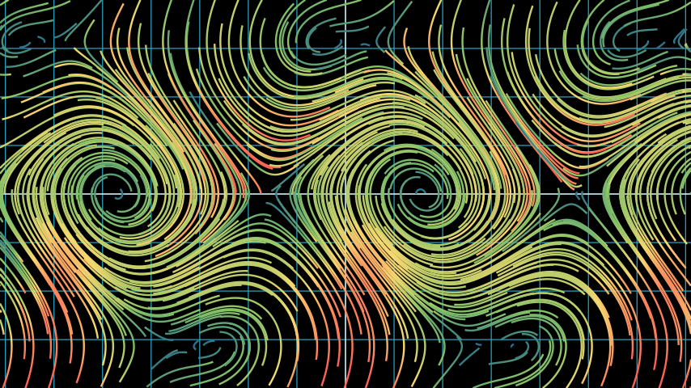

   manim-plots

.. code-block:: python

   import numpy as np
   from manim import Scene
   import manim_plots as mp

   def swirl(p):
       x, y = (p[0], p[1])
       return np.array([np.sin(y), np.cos(x) - 0.3 * y, 0.0])

   class StreamLines(Scene):
       def construct(self):
           plane = mp.NumberPlane()
           lines = plane.get_stream_lines(swirl, stroke_width=2)
           self.add(plane, lines)

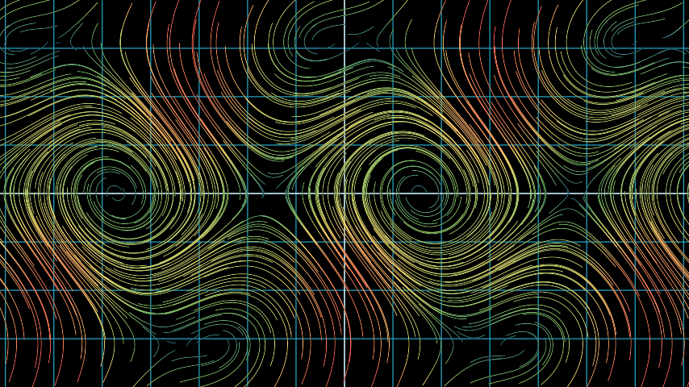

   plain Manim

.. code-block:: python

   import numpy as np
   from manim import NumberPlane, Scene, StreamLines

   def swirl(p):
       x, y = (p[0], p[1])
       return np.array([np.sin(y), np.cos(x) - 0.3 * y, 0.0])

   class StreamLinesManim(Scene):
       def construct(self):
           parts = NumberPlane()
           parts2 = StreamLines(swirl, stroke_width=2)
           self.add(parts, parts2)

Polar
-----

Manim's docs example: a π-radians plane of size 6 with coordinates and a rose ``2 sin
5θ``.

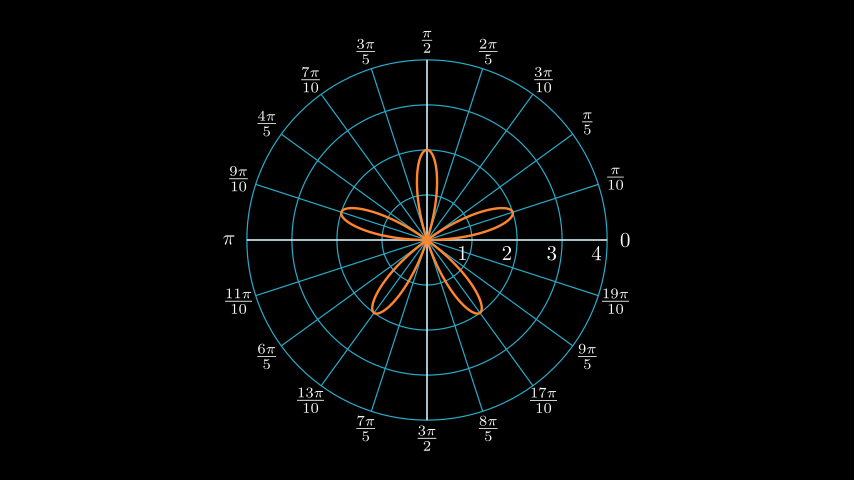

   manim-plots

.. code-block:: python

   import numpy as np
   from manim import ORANGE, TAU, Scene
   import manim_plots as mp

   def rose(theta):
       return 2 * np.sin(5 * theta)

   class PolarPlane(Scene):
       def construct(self):
           plane = mp.PolarPlane(
               azimuth_units="PI radians",
               size=6,
               azimuth_label_font_size=33.6,
               radius_config={"font_size": 33.6},
           ).add_coordinates()
           plot_polar_graph = plane.plot_polar_graph(rose, [0, TAU], color=ORANGE)
           self.add(plane, plot_polar_graph)

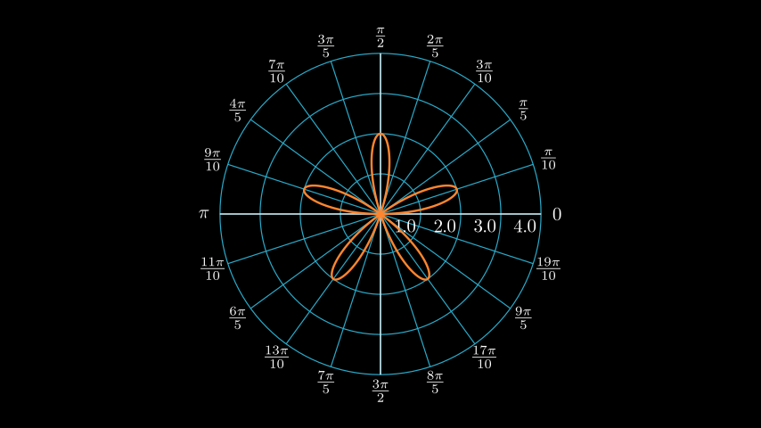

   plain Manim

.. code-block:: python

   import numpy as np
   from manim import ORANGE, TAU, PolarPlane, Scene

   def rose(theta):
       return 2 * np.sin(5 * theta)

   class PolarPlaneManim(Scene):
       def construct(self):
           plane = PolarPlane(
               azimuth_units="PI radians",
               size=6,
               azimuth_label_font_size=33.6,
               radius_config={"font_size": 33.6},
           ).add_coordinates()
           plot_polar_graph = plane.plot_polar_graph(rose, [0, TAU], color=ORANGE)
           self.add(plane, plot_polar_graph)

A true polar system: a flower ``1.5 + sin 5θ`` and a cardioid on ``r`` in (0, 3), ticks
on the rim pointing in, numbers in π radians, radial numbers at 22.5°.

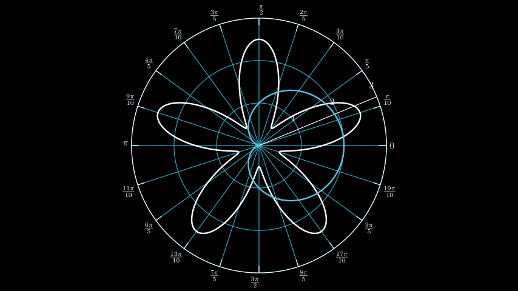

   manim-plots

.. code-block:: python

   import numpy as np
   from manim import Scene
   import manim_plots as mp

   class PolarAxesRose(Scene):
       def construct(self):
           ax = mp.PolarAxes(r_range=(0, 3, 1), size=7)
           curve = ax.plot(lambda t: 1.5 + np.sin(5 * t))
           curve2 = ax.plot(lambda t: 1 + np.cos(t))
           self.add(ax, curve, curve2)

The 3D system and the box frame
-------------------------------

A helix of height 10 on the default axes, cut at z = ±4; Manim's runs past the box.

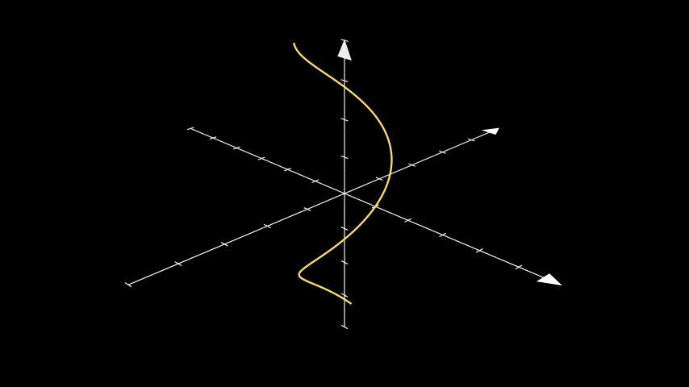

   manim-plots

.. code-block:: python

   import numpy as np
   from manim import DEGREES, YELLOW, Scene
   import manim_plots as mp
   from manim import ThreeDScene

   def camera(scene: Scene) -> None:
       turn = scene.set_camera_orientation
       turn(phi=65 * DEGREES, theta=-45 * DEGREES)

   def helix(t):
       return np.array([np.cos(t), np.sin(t), t])

   class ThreeDHelixClipped(ThreeDScene):
       def construct(self):
           camera(self)
           ax = mp.ThreeDAxes()
           curve = ax.plot_parametric_curve(helix, t_range=(-5, 5), color=YELLOW)
           self.add(ax, curve)

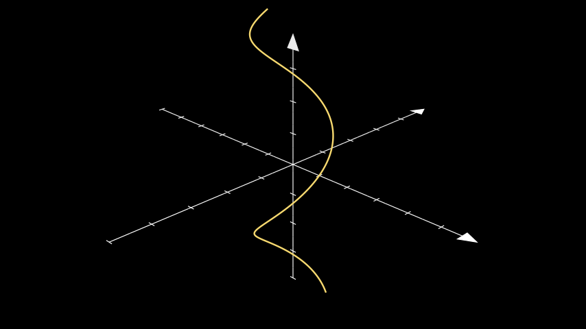

   plain Manim

.. code-block:: python

   import numpy as np
   from manim import DEGREES, YELLOW, Scene, ThreeDAxes
   from manim import ThreeDScene

   def camera(scene: Scene) -> None:
       turn = scene.set_camera_orientation
       turn(phi=65 * DEGREES, theta=-45 * DEGREES)

   def helix(t):
       return np.array([np.cos(t), np.sin(t), t])

   class ThreeDHelixClippedManim(ThreeDScene):
       def construct(self):
           camera(self)
           ax = ThreeDAxes()
           curve = ax.plot_parametric_curve(helix, t_range=(-5, 5), color=YELLOW)
           self.add(ax, curve)

``frame="box"``: three grey panes with grids on the far sides, the axes on the near
edges, numbers facing the camera; a helix and its points, as matplotlib draws it.

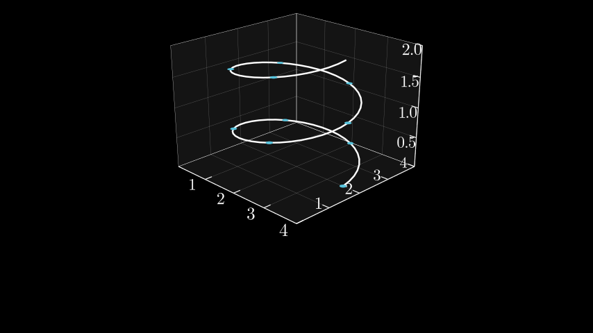

   manim-plots

.. code-block:: python

   import numpy as np
   from manim import DEGREES, Scene
   import manim_plots as mp
   from manim import ThreeDScene

   def camera(scene: Scene) -> None:
       turn = scene.set_camera_orientation
       turn(phi=65 * DEGREES, theta=-45 * DEGREES)

   def surface_points():
       t = np.linspace(0, 4 * np.pi, 80)
       return (2 + 1.5 * np.cos(t), 2 + 1.5 * np.sin(t), t / (4 * np.pi) * 2)

   class ThreeDBox(ThreeDScene):
       def construct(self):
           camera(self)
           ax = mp.ThreeDAxes(
               x_range=(0, 4, 1),
               y_range=(0, 4, 1),
               z_range=(0, 2, 0.5),
               x_length=4,
               y_length=4,
               z_length=3,
               frame="box",
           )
           x, y, z = surface_points()
           line = ax.line(x, y, z)
           dots = ax.scatter(x[::8], y[::8], z[::8])
           self.add(ax, line, dots)

Surfaces
--------

Manim's ``PlotSurfaceExample`` on the library: colour by height, each face by its centre.

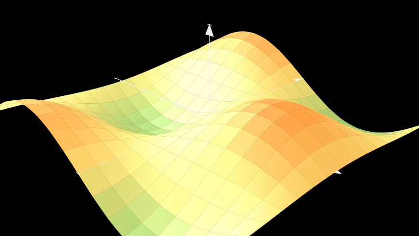

   manim-plots

.. code-block:: python

   import numpy as np
   from manim import BLUE, DEGREES, GREEN, ORANGE, RED, YELLOW, Scene
   import manim_plots as mp
   from manim import ThreeDScene

   SCALE = [BLUE, GREEN, YELLOW, ORANGE, RED]

   def camera(scene: Scene) -> None:
       turn = scene.set_camera_orientation
       turn(phi=65 * DEGREES, theta=-45 * DEGREES)

   def saddle(u, v):
       return 2 * np.sin(u) * np.cos(v)

   class SurfaceSaddle(ThreeDScene):
       def construct(self):
           camera(self)
           ax = mp.ThreeDAxes(x_range=(-3, 3, 1), y_range=(-3, 3, 1), z_range=(-5, 5, 1))
           surface = ax.plot_surface(
               saddle, (-3, 3), (-3, 3), resolution=16, colorscale=SCALE
           )
           self.add(ax, surface)

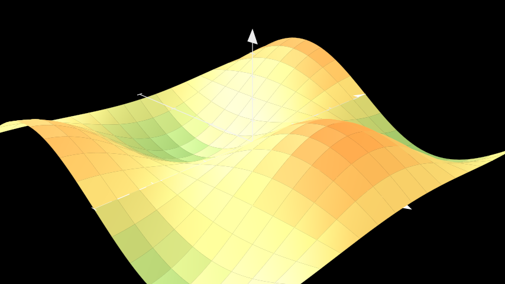

   plain Manim

.. code-block:: python

   import numpy as np
   from manim import BLUE, DEGREES, GREEN, ORANGE, RED, YELLOW, Scene, ThreeDAxes
   from manim import ThreeDScene

   SCALE = [BLUE, GREEN, YELLOW, ORANGE, RED]

   def camera(scene: Scene) -> None:
       turn = scene.set_camera_orientation
       turn(phi=65 * DEGREES, theta=-45 * DEGREES)

   def saddle(u, v):
       return 2 * np.sin(u) * np.cos(v)

   class SurfaceSaddleManim(ThreeDScene):
       def construct(self):
           camera(self)
           ax = ThreeDAxes(x_range=(-3, 3, 1), y_range=(-3, 3, 1), z_range=(-5, 5, 1))
           surface = ax.plot_surface(
               saddle, (-3, 3), (-3, 3), resolution=16, colorscale=SCALE
           )
           self.add(ax, surface)

Geometry
--------

An oblique plane cut to the box, a line through it and their crossing.

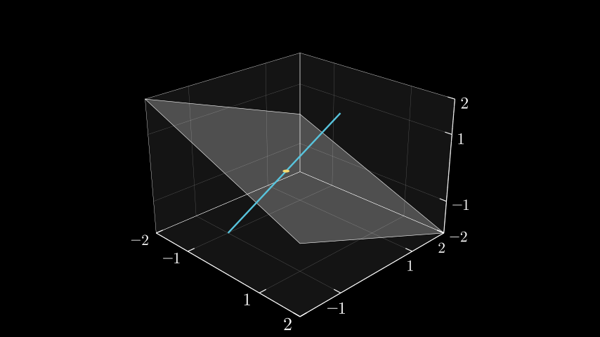

   manim-plots

.. code-block:: python

   from typing import Any
   from manim import DEGREES, Scene
   import manim_plots as mp
   from manim import ThreeDScene

   SIZE: dict[str, Any] = {"x_length": 5, "y_length": 5, "z_length": 3.5}
   BOX: dict[str, Any] = {
       "x_range": (-2, 2, 1),
       "y_range": (-2, 2, 1),
       "z_range": (-2, 2, 1),
       "frame": "box",
       **SIZE,
   }

   def camera(scene: Scene) -> None:
       turn = scene.set_camera_orientation
       turn(phi=65 * DEGREES, theta=-45 * DEGREES)

   class PlaneLineAndPoint(ThreeDScene):
       def construct(self):
           camera(self)
           ax = mp.ThreeDAxes(**BOX)
           plane = ax.plane((0, 0, 0), (1, 1, 2))
           line = ax.axline((-1, -1, -2), direction=(1, 0.5, 2))
           crossing = ax.intersection(plane, line)
           self.add(ax, plane, line, crossing)

Fields in 3D
------------

The same swirl on a coarser grid with Manim's ``Arrow3D``.

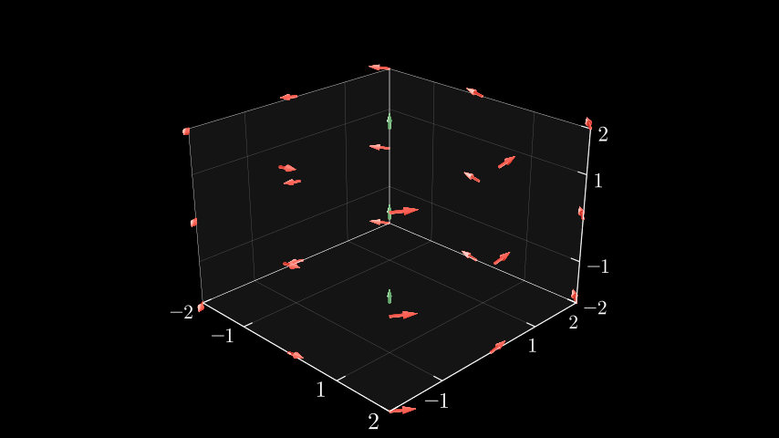

   manim-plots

.. code-block:: python

   from typing import Any
   import numpy as np
   from manim import DEGREES, Scene
   import manim_plots as mp
   from manim import ThreeDScene

   BOX: dict[str, Any] = {
       "x_range": (-2, 2, 1),
       "y_range": (-2, 2, 1),
       "z_range": (-2, 2, 1),
       "x_length": 5,
       "y_length": 5,
       "z_length": 3.5,
       "frame": "box",
   }

   def camera(scene: Scene) -> None:
       turn = scene.set_camera_orientation
       turn(phi=65 * DEGREES, theta=-45 * DEGREES)

   def swirl(p: np.ndarray) -> np.ndarray:
       return np.array([-p[1], p[0], 0.5])

   class FieldThreeDArrows(ThreeDScene):
       def construct(self):
           camera(self)
           ax = mp.ThreeDAxes(**BOX)
           field = ax.get_vector_field(
               swirl,
               arrow="3d",
               x_range=(-2, 2, 2),
               y_range=(-2, 2, 2),
               z_range=(-2, 2, 2),
           )
           self.add(ax, field)

Slices
------

A translucent saddle with its slices at x = 1 and y = -1 drawn on it.

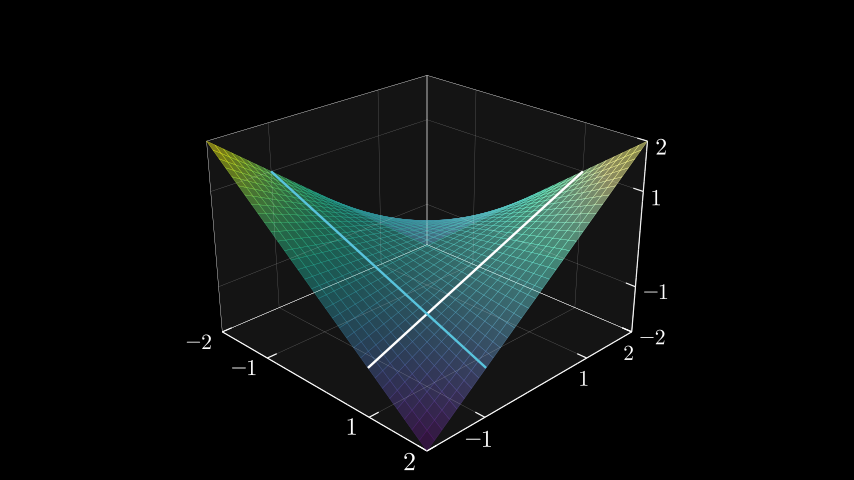

   manim-plots

.. code-block:: python

   from typing import Any
   from manim import DEGREES, Scene
   import manim_plots as mp
   from manim import ThreeDScene

   BOX: dict[str, Any] = {
       "x_range": (-2, 2, 1),
       "y_range": (-2, 2, 1),
       "z_range": (-2, 2, 1),
       "x_length": 5,
       "y_length": 5,
       "z_length": 3.5,
       "frame": "box",
   }

   def camera(scene: Scene) -> None:
       turn = scene.set_camera_orientation
       turn(phi=65 * DEGREES, theta=-45 * DEGREES)

   class SlicesOfASurface(ThreeDScene):
       def construct(self):
           camera(self)
           ax = mp.ThreeDAxes(**BOX)
           surface = ax.plot_surface(
               lambda u, v: u * v / 2, colorscale="viridis", fill_opacity=0.5
           )
           cut = surface.slice(x=1)
           cut2 = surface.slice(y=-1)
           self.add(ax, surface, cut, cut2)

More plot types
---------------

Stems of a sampled sine and a three-curve waterfall behind them.

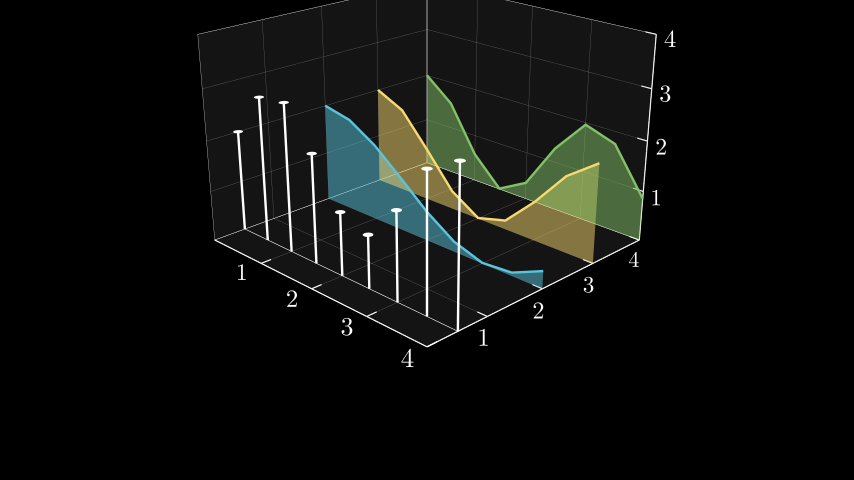

   manim-plots

.. code-block:: python

   from typing import Any
   import numpy as np
   from manim import DEGREES, Scene
   import manim_plots as mp
   from manim import ThreeDScene

   BOX: dict[str, Any] = {
       "x_range": (0, 4, 1),
       "y_range": (0, 4, 1),
       "z_range": (0, 4, 1),
       "x_length": 5,
       "y_length": 5,
       "z_length": 3.5,
       "frame": "box",
   }

   def camera(scene: Scene) -> None:
       turn = scene.set_camera_orientation
       turn(phi=65 * DEGREES, theta=-45 * DEGREES)

   class StemsAndWaterfall(ThreeDScene):
       def construct(self):
           camera(self)
           ax = mp.ThreeDAxes(**BOX)
           x = np.linspace(0, 4, 9)
           stems = ax.stem(x, 0.5 + 0 * x, 2 + np.sin(2 * x))
           curves = [1 + np.cos(x * k) for k in (1, 1.5, 2)]
           waterfall = ax.waterfall(x, curves, positions=[2, 3, 4])
           self.add(ax, waterfall, stems)

Occlusion
---------

A helix passing through an opaque saddle: the turns below it are hidden where the saddle
covers them.

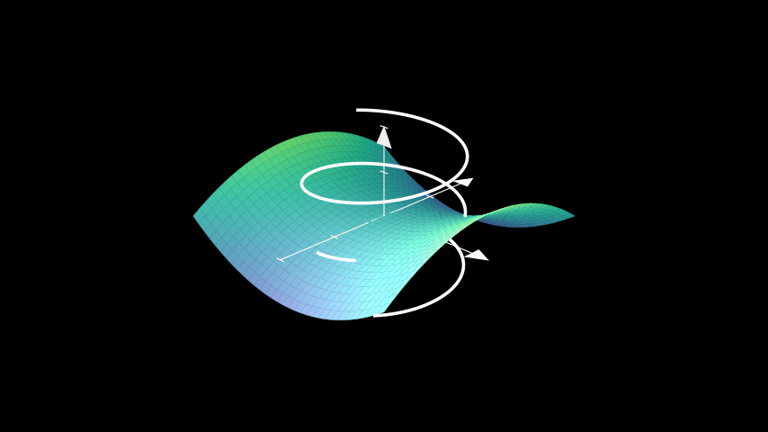

   manim-plots

.. code-block:: python

   from typing import Any
   import numpy as np
   from manim import DEGREES, Scene
   import manim_plots as mp
   from manim import ThreeDScene

   SIZE: dict[str, Any] = {
       "x_range": (-2, 2, 1),
       "y_range": (-2, 2, 1),
       "z_range": (-2, 2, 1),
       "x_length": 5,
       "y_length": 5,
       "z_length": 3.5,
   }

   def camera(scene: Scene) -> None:
       turn = scene.set_camera_orientation
       turn(phi=65 * DEGREES, theta=-45 * DEGREES)

   def helix(t: float) -> np.ndarray:
       return np.array([1.2 * np.cos(t), 1.2 * np.sin(t), t / 5])

   class HelixThroughASurface(ThreeDScene):
       def construct(self):
           camera(self)
           ax = mp.ThreeDAxes(**SIZE)
           surface = ax.plot_surface(
               lambda u, v: (u * u - v * v) / 4, colorscale="viridis"
           )
           curve = ax.plot_parametric_curve(helix, t_range=(-9, 9), stroke_width=6)
           self.add(ax, surface, curve)

The same scene with ``occlusion=False``: Manim's picture, the helix drawn whole on top
or below by the camera's sort.

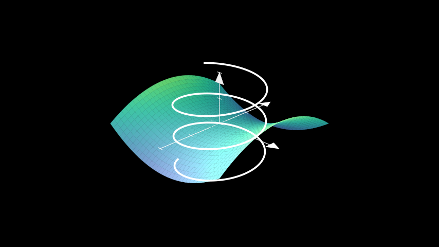

   manim-plots

.. code-block:: python

   from typing import Any
   import numpy as np
   from manim import DEGREES, Scene
   import manim_plots as mp
   from manim import ThreeDScene

   SIZE: dict[str, Any] = {
       "x_range": (-2, 2, 1),
       "y_range": (-2, 2, 1),
       "z_range": (-2, 2, 1),
       "x_length": 5,
       "y_length": 5,
       "z_length": 3.5,
   }

   def camera(scene: Scene) -> None:
       turn = scene.set_camera_orientation
       turn(phi=65 * DEGREES, theta=-45 * DEGREES)

   def helix(t: float) -> np.ndarray:
       return np.array([1.2 * np.cos(t), 1.2 * np.sin(t), t / 5])

   class HelixThroughASurfaceWithoutOcclusion(ThreeDScene):
       def construct(self):
           camera(self)
           ax = mp.ThreeDAxes(occlusion=False, **SIZE)
           surface = ax.plot_surface(
               lambda u, v: (u * u - v * v) / 4, colorscale="viridis"
           )
           curve = ax.plot_parametric_curve(helix, t_range=(-9, 9), stroke_width=6)
           self.add(ax, surface, curve)

Bars and categories
-------------------

Manim's ``BarChart`` on the library, with its bar labels.

.. figure:: ../../tests/visual/baselines/test_bar_pictures/test_bar_chart.png
   :alt: Bars and categories - manim-plots
   :width: 100%

   manim-plots

.. code-block:: python

   from manim import Scene
   import manim_plots as mp

   VALUES = [3.0, -1.0, 2.0, 4.5, 1.0]
   NAMES = ["one", "two", "three", "four", "five"]

   class BarChart(Scene):
       def construct(self):
           chart = mp.BarChart(VALUES, bar_names=NAMES, y_range=(-2, 5, 1))
           labels = chart.get_bar_labels(font_size=24)
           self.add(chart, labels)

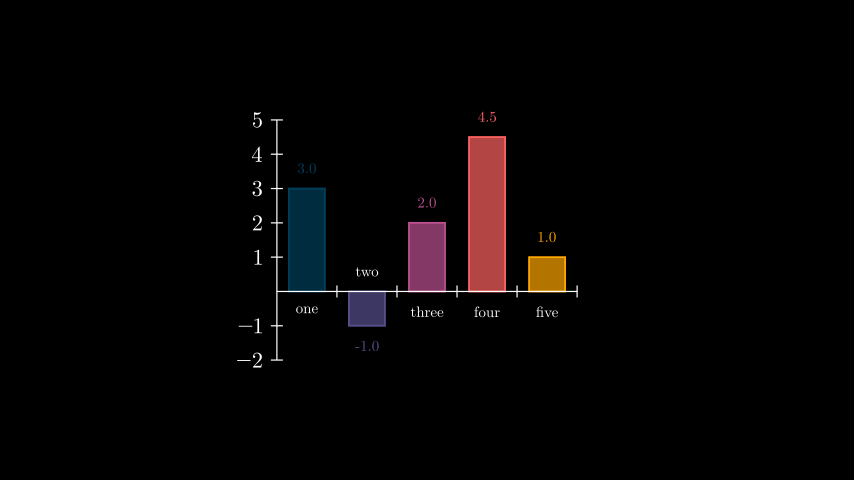

   plain Manim

.. code-block:: python

   from manim import BarChart, Scene

   VALUES = [3.0, -1.0, 2.0, 4.5, 1.0]
   NAMES = ["one", "two", "three", "four", "five"]

   class BarChartManim(Scene):
       def construct(self):
           chart = BarChart(VALUES, bar_names=NAMES, y_range=[-2, 5, 1])
           labels = chart.get_bar_labels(font_size=24)
           self.add(chart, labels)

Three datasets grouped on categories, with a legend.

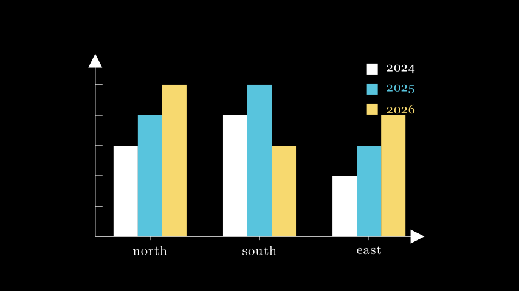

   manim-plots

.. code-block:: python

   from manim import Scene
   import manim_plots as mp

   class GroupedAndStacked(Scene):
       def construct(self):
           ax = mp.Axes(y_range=(0, 6, 1), x_length=9, y_length=5)
           group = ax.grouped_bar(
               {"2024": [3, 4, 2], "2025": [4, 5, 3], "2026": [5, 3, 4]},
               tick_labels=["north", "south", "east"],
           )
           legend = ax.legend()
           self.add(ax, group, legend)

Histograms
----------

Three thousand normal samples, each bar coloured by its position (plasma).

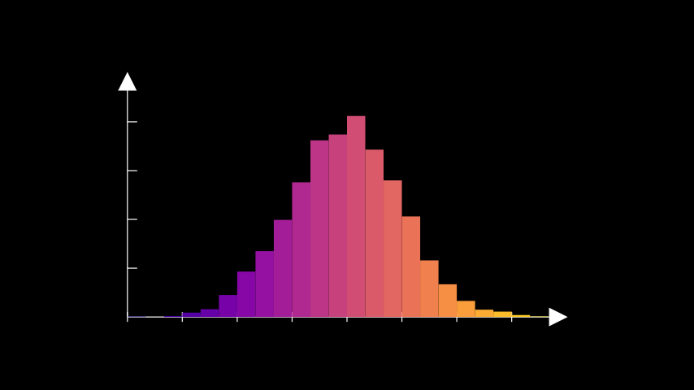

   manim-plots

.. code-block:: python

   import numpy as np
   from manim import Scene
   import manim_plots as mp

   RNG = np.random.default_rng(2)

   def axes() -> mp.Axes:
       ax = mp.Axes(x_range=(-4, 4, 1), y_range=(0, 500, 100), x_length=9, y_length=5)
       ax.y.set_position("left")
       return ax

   class SpectrumHistogram(Scene):
       def construct(self):
           ax = axes()
           h = ax.hist(
               RNG.normal(0, 1, 3000),
               bins=24,
               range=(-4, 4),
               color_by="x",
               colorscale="plasma",
           )
           self.add(ax, h)

Histograms in 3D
----------------

Matplotlib's 3D histogram example in one call: counts as shaded columns coloured by
viridis, with a colorbar.

   manim-plots

.. code-block:: python

   import numpy as np
   from manim import DEGREES, Scene
   import manim_plots as mp
   from manim import ThreeDScene

   def camera(scene: Scene) -> None:
       turn = scene.set_camera_orientation
       turn(phi=65 * DEGREES, theta=-45 * DEGREES)

   class Hist3DColouredByCount(ThreeDScene):
       def construct(self):
           camera(self)
           ax = mp.ThreeDAxes(
               x_range=(-3, 3, 1),
               y_range=(-3, 3, 1),
               z_range=(0, 180, 60),
               x_length=5,
               y_length=5,
               z_length=3.5,
               frame="box",
           )
           rng = np.random.default_rng(8)
           x, y = (rng.normal(0, 1, 2000), rng.normal(0, 1, 2000))
           h = ax.hist3d(x, y, bins=8, range=((-3, 3), (-3, 3)))
           colorbar = ax.colorbar(h, label="n")
           self.add(ax, h, colorbar)

Axis kinds
----------

A date axis over 2024 with concise month labels.

   manim-plots

.. code-block:: python

   from datetime import datetime, timedelta
   import numpy as np
   from manim import Scene
   import manim_plots as mp

   class AYearOfDailyValues(Scene):
       def construct(self):
           ax = mp.Axes(y_range=(-2, 2, 1), x_length=10, y_length=4)
           start = datetime(2024, 1, 1)
           when = [start + timedelta(days=k) for k in range(366)]
           values = np.sin(np.arange(366) / 29) + 0.3 * np.sin(np.arange(366) / 3)
           line = ax.line(when, values)
           self.add(ax, line)

Two clusters of values far apart, the empty stretch between them cut out.

   manim-plots

.. code-block:: python

   import numpy as np
   from manim import Scene
   import manim_plots as mp

   class BrokenAxis(Scene):
       def construct(self):
           ax = mp.Axes(x_range=(0, 10, 1), y_range=(0, 100, 10), x_length=8, y_length=5)
           ax.y.set_breaks([(20, 80)])
           ax.y.add_numbers()
           low = ax.scatter(np.arange(1, 10), [5, 8, 12, 9, 15, 11, 7, 14, 10])
           high = ax.scatter(np.arange(1, 10), [85, 90, 88, 95, 87, 92, 89, 91, 86])
           self.add(ax, low, high)

Heatmaps
--------

A 6 by 6 table of values with each cell labelled, dark text on light cells.

   manim-plots

.. code-block:: python

   import numpy as np
   from manim import Scene
   import manim_plots as mp

   def axes() -> mp.Axes:
       return mp.Axes(x_range=(0, 6, 1), y_range=(0, 6, 1), x_length=6, y_length=6)

   class AnnotatedHeatmap(Scene):
       def construct(self):
           ax = axes()
           z = np.add.outer(np.arange(6), np.arange(6)) % 7 / 6
           img = ax.imshow(z, extent=(0, 6, 0, 6))
           labels = img.label_cells(fmt="{:.1f}", font_size=18)
           self.add(ax, img, labels)

Statistics
----------

Three samples as box plots on the left half and violins on the right.

   manim-plots

.. code-block:: python

   import numpy as np
   from manim import Scene
   import manim_plots as mp

   class BoxesAndViolins(Scene):
       def construct(self):
           rng = np.random.default_rng(7)
           samples = [
               rng.normal(0, 1, 300),
               rng.standard_t(3, 300),
               np.concatenate([rng.normal(-1.5, 0.5, 150), rng.normal(1.5, 0.5, 150)]),
           ]
           ax = mp.Axes(x_range=(0, 8, 1), y_range=(-5, 5, 1), x_length=10, y_length=6)
           boxes = ax.boxplot(samples, positions=[1, 2, 3])
           violins = ax.violinplot(samples, positions=[5, 6, 7], showmedians=True)
           self.add(ax, boxes, violins)

Volumes
-------

A ball of voxels, each coloured by the height of its centre.

   manim-plots

.. code-block:: python

   import numpy as np
   from manim import DEGREES, Scene
   import manim_plots as mp
   from manim import ThreeDScene

   def camera(scene: Scene) -> None:
       scene.set_camera_orientation(phi=65 * DEGREES, theta=-50 * DEGREES)

   class VoxelSphereColouredByHeight(ThreeDScene):
       def construct(self):
           camera(self)
           ax = mp.ThreeDAxes(
               x_range=(0, 8, 2),
               y_range=(0, 8, 2),
               z_range=(0, 8, 2),
               x_length=5,
               y_length=5,
               z_length=3.5,
               frame="box",
           )
           i, j, k = np.indices((8, 8, 8)) + 0.5
           filled = (i - 4) ** 2 + (j - 4) ** 2 + (k - 4) ** 2 < 12
           voxels = ax.voxels(filled, c=k, colorscale="plasma")
           self.add(ax, voxels)

The level set of a torus function, shaded and coloured along z.

   manim-plots

.. code-block:: python

   import numpy as np
   from manim import DEGREES, Scene
   import manim_plots as mp
   from manim import ThreeDScene

   def camera(scene: Scene) -> None:
       scene.set_camera_orientation(phi=65 * DEGREES, theta=-50 * DEGREES)

   class IsosurfaceOfATorus(ThreeDScene):
       def construct(self):
           camera(self)
           ax = mp.ThreeDAxes(x_range=(-2, 2, 1), y_range=(-2, 2, 1), z_range=(-1, 1, 0.5))
           surface = ax.plot_isosurface(
               lambda x, y, z: (np.sqrt(x**2 + y**2) - 1.2) ** 2 + z**2,
               0.16,
               resolution=28,
               colorscale="viridis",
           )
           self.add(ax, surface)
