Gallery
=======

These 21 reviewed pictures come from the visual tests. Each example is independent:
save its code as ``gallery.py`` and render its named Scene with Manim, for example:

.. code-block:: text

   manim -ql --renderer cairo gallery.py SineOnDefaultAxes

The still pictures use 854 by 480 pixels. Animation sheets show successive frames
from left to right, then top to bottom, at 6 frames per second and 427 by 240 pixels
per frame, including the final state. Rendering the Scene produces the animation;
the test harness arranges its frames into the sheet shown here.

The two gap examples filter the expected ManimPlotsWarning about a split path.
Other examples leave warnings enabled.

Sine on default axes
--------------------

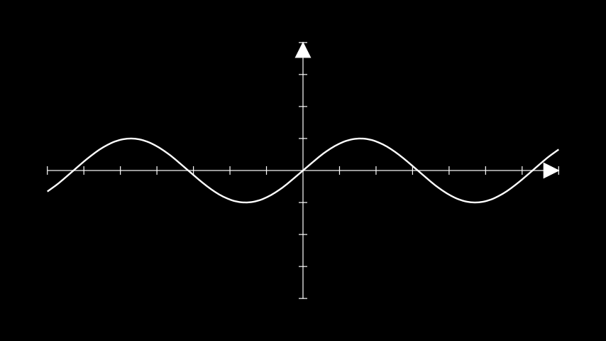

   A sine on the default axes. The curve is clipped to the viewport.

.. code-block:: python

   import numpy as np
   from manim import Scene

   import manim_plots as mp

   class SineOnDefaultAxes(Scene):
       def construct(self):
           ax = mp.Axes()
           self.add(ax, ax.plot(np.sin))

A pole on offset axes
---------------------

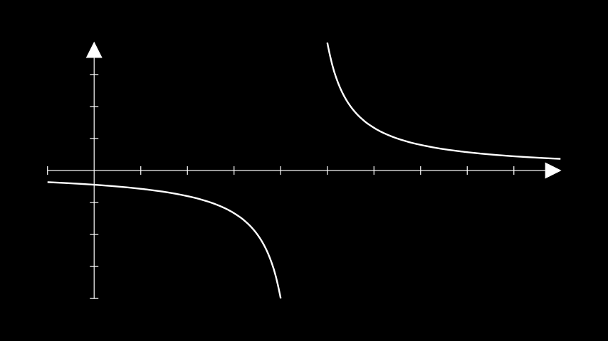

   The two sides of the pole stay separate and are clipped at the viewport.

.. code-block:: python

   import warnings
   from manim import Scene

   import manim_plots as mp

   class PoleOnOffsetAxes(Scene):
       def construct(self):
           with warnings.catch_warnings():
               warnings.filterwarnings(
                   "ignore",
                   message="source is empty or contains invalid samples or a pole;.*",
                   category=mp.ManimPlotsWarning,
               )
               ax = mp.Axes(x_range=(-1, 10, 1), y_range=(-2, 2, 0.5))
               self.add(ax, ax.plot(lambda x: 1 / (x - 4.5)))

Numbers on default axes
-----------------------

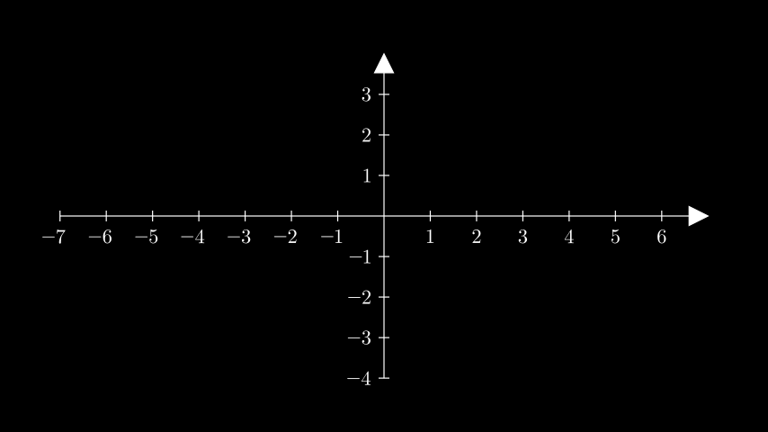

   Numbers use Manim's default positions and font size. The tick and number under each
   tip are omitted.

.. code-block:: python

   from manim import Scene

   import manim_plots as mp

   class NumbersOnDefaultAxes(Scene):
       def construct(self):
           self.add(mp.Axes(axis_config={"include_numbers": True}))

Even steps and quarters
-----------------------

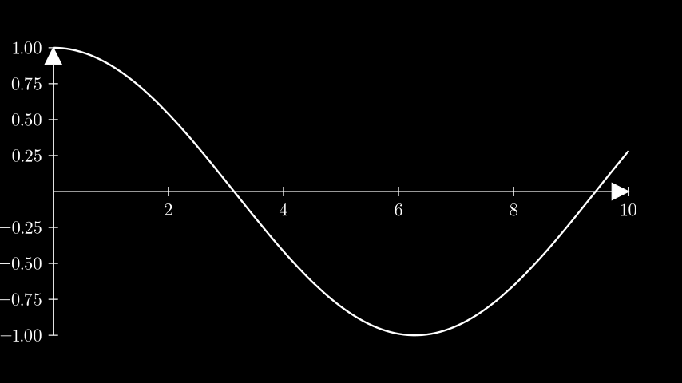

   A cosine with x ticks every 2 and y ticks every 0.25.

.. code-block:: python

   import numpy as np
   from manim import Scene

   import manim_plots as mp

   class EvenStepsAndQuarters(Scene):
       def construct(self):
           ax = mp.Axes(
               x_range=(0, 10, 2),
               y_range=(-1, 1, 0.25),
               axis_config={"include_numbers": True},
           )
           self.add(ax, ax.plot(lambda x: np.cos(x / 2)))

Manim LogBase ranges
--------------------

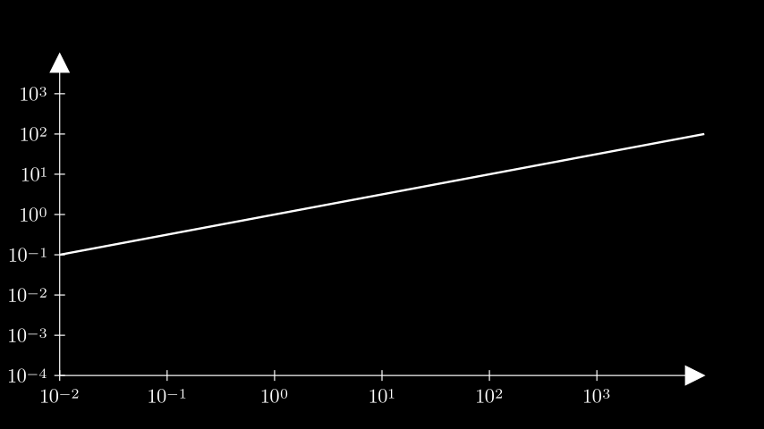

   Manim's LogBase in axis_config applies to both axes here. Its ranges are exponents,
   and its labels are powers of ten.

.. code-block:: python

   import numpy as np
   from manim import LogBase, Scene

   import manim_plots as mp

   class LogBaseAxis(Scene):
       def construct(self):
           ax = mp.Axes(
               x_range=(-2, 4, 1),
               axis_config={"scaling": LogBase(), "include_numbers": True},
           )
           self.add(ax, ax.plot(lambda x: np.log10(x) / 2))

A number plane
--------------

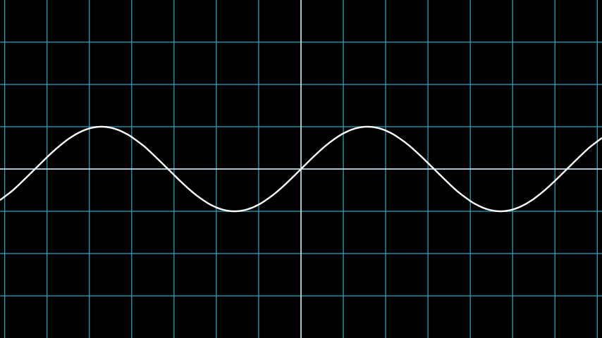

   The default NumberPlane background and faded grid, with a sine.

.. code-block:: python

   import numpy as np
   from manim import Scene

   import manim_plots as mp

   class NumberPlaneSine(Scene):
       def construct(self):
           plane = mp.NumberPlane()
           self.add(plane, plane.plot(np.sin))

A log scale with minor ticks
----------------------------

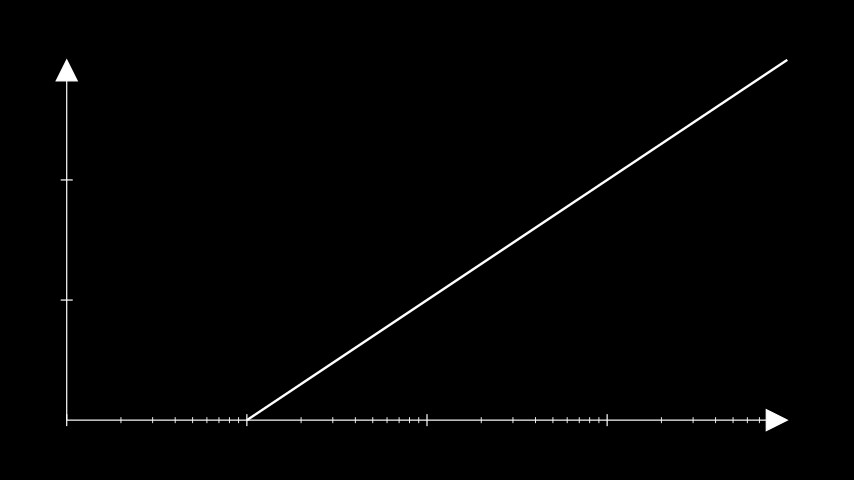

   The library's x_scale="log" takes data ranges. log10 is straight on these axes, with
   minor ticks between decades.

.. code-block:: python

   import numpy as np
   from manim import Scene

   import manim_plots as mp

   class LogScaleWithMinorTicks(Scene):
       def construct(self):
           ax = mp.Axes(x_range=(0.1, 1000), y_range=(0, 3, 1), x_scale="log")
           self.add(ax, ax.plot(np.log10, x_range=(0.1, 1000)))

Border axes, mirror and grid
----------------------------

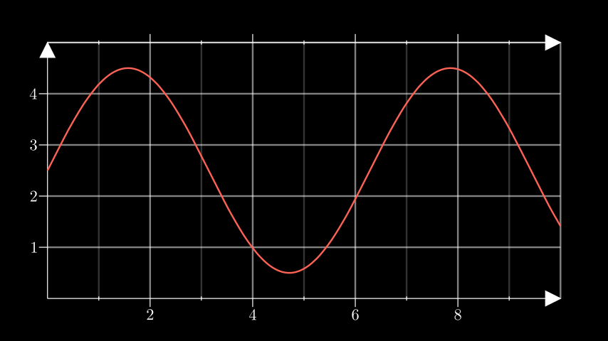

   Outward ticks, a mirrored top axis, and separate major and minor grids.

.. code-block:: python

   import numpy as np
   from manim import RED, Scene

   import manim_plots as mp
   from manim_plots import MultipleLocator
   from manim_plots.mobjects.axis import TickDirection

   class BorderAxes(Scene):
       def construct(self):
           ax = mp.Axes(
               x_range=(0, 10, 2), y_range=(0, 5, 1), axis_config={"include_numbers": True}
           )
           ax.x.set_position("bottom")
           ax.y.set_position("left")
           ax.x.set_locator(MultipleLocator(2), minor=MultipleLocator(1))
           for axis in (ax.x, ax.y):
               axis.set_tick_style(direction=TickDirection.OUT)
               axis.set_grid("major", stroke_opacity=0.5)
           ax.x.set_grid("minor", stroke_opacity=0.2)
           top = ax.x.mirror()
           self.add(ax, top, ax.plot(lambda x: 2.5 + 2 * np.sin(x), color=RED))

Rotated labels on a dense axis
------------------------------

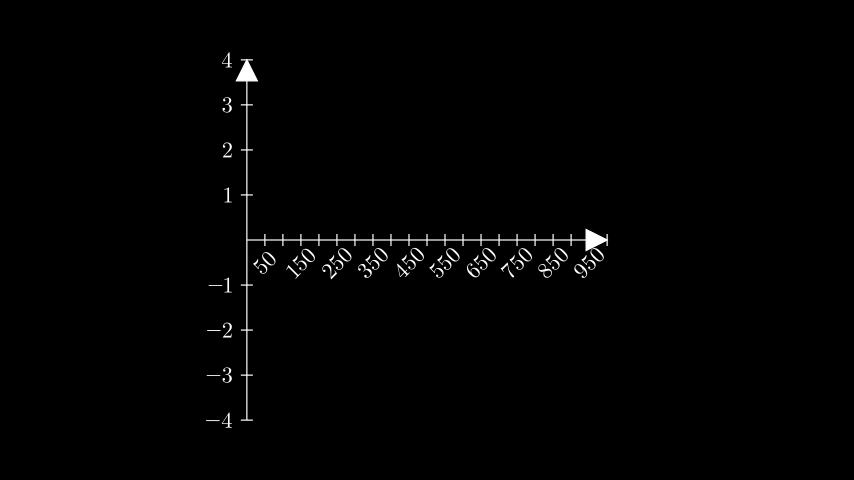

   The rotate overlap policy turns the numbers by 45 degrees and hides those that still
   collide.

.. code-block:: python

   from manim import Scene

   import manim_plots as mp

   class RotatedLabels(Scene):
       def construct(self):
           ax = mp.Axes(
               x_range=(0, 1000, 50), x_length=6, axis_config={"include_numbers": True}
           )
           ax.x.set_label_style(overlap="rotate")
           self.add(ax)

An aspect lock
--------------

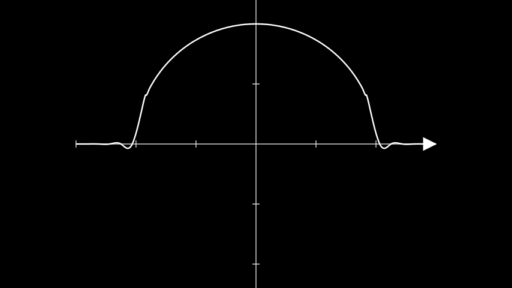

   Equal data units have equal scene lengths. This sampled upper semicircle uses the
   test's smoothing and zero-valued tails.

.. code-block:: python

   import numpy as np
   from manim import Scene

   import manim_plots as mp

   class AspectLock(Scene):
       def construct(self):
           ax = mp.Axes(x_range=(-3, 3, 1), y_range=(-3, 3, 1), x_length=10, aspect=1.0)
           self.add(ax, ax.plot(lambda x: np.sqrt(np.maximum(4 - x**2, 0))))

An array line with a gap
------------------------

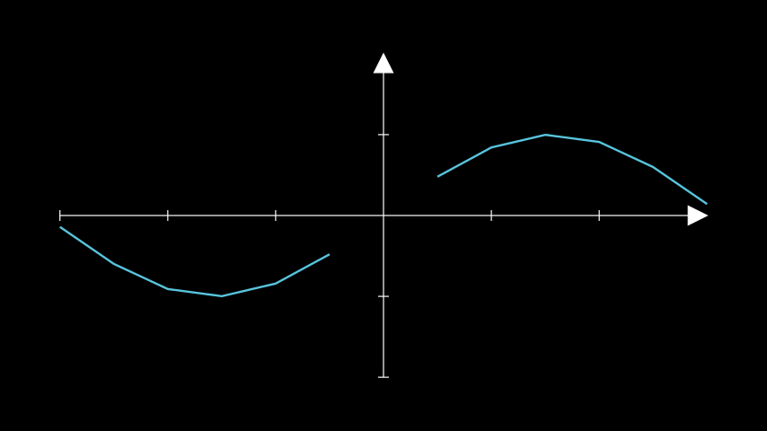

   A NaN sample splits an array line. The data is retained unchanged.

.. code-block:: python

   import warnings
   import numpy as np
   from manim import BLUE, Scene

   import manim_plots as mp

   class LineWithGap(Scene):
       def construct(self):
           with warnings.catch_warnings():
               warnings.filterwarnings(
                   "ignore",
                   message="source is empty or contains invalid samples or a pole;.*",
                   category=mp.ManimPlotsWarning,
               )
               ax = mp.Axes(x_range=(-3, 3, 1), y_range=(-2, 2, 1))
               xs = np.linspace(-3, 3, 13)
               ys = np.sin(xs)
               ys[6] = np.nan
               self.add(ax, ax.line(xs, ys, color=BLUE))

Scatter with a custom marker
----------------------------

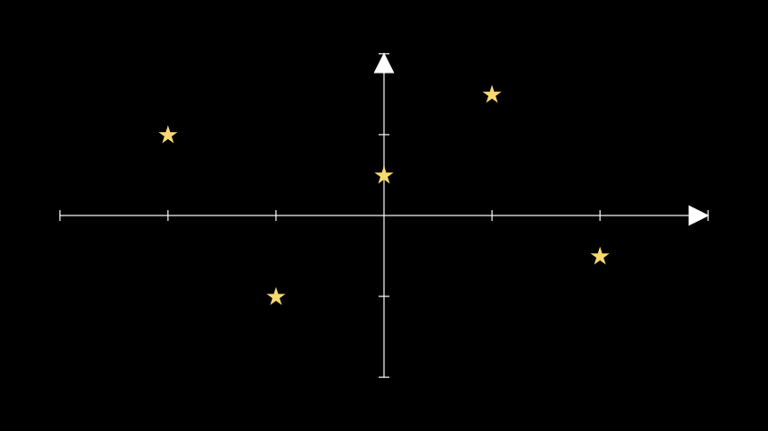

   A native Star supplies each marker's shape and style. The point outside the viewport
   is hidden.

.. code-block:: python

   from manim import Scene, Star, YELLOW

   import manim_plots as mp

   class ScatterWithStars(Scene):
       def construct(self):
           ax = mp.Axes(x_range=(-3, 3, 1), y_range=(-2, 2, 1))
           marker = Star(outer_radius=0.12, color=YELLOW, fill_opacity=1)
           self.add(
               ax,
               ax.scatter([-2, -1, 0, 1, 2, 5], [1, -1, 0.5, 1.5, -0.5, 0], marker=marker),
           )

A clipped parametric spiral
---------------------------

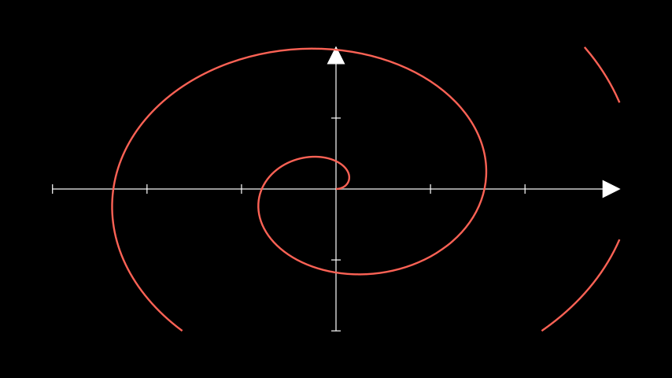

   The spiral is sampled in parameter order and clipped where it leaves the axes.

.. code-block:: python

   import numpy as np
   from manim import RED, Scene

   import manim_plots as mp

   class ClippedSpiral(Scene):
       def construct(self):
           ax = mp.Axes(x_range=(-3, 3, 1), y_range=(-2, 2, 1))
           spiral = ax.plot_parametric_curve(
               lambda t: (0.25 * t * np.cos(t), 0.25 * t * np.sin(t)),
               t_range=(0, 14),
               color=RED,
           )
           self.add(ax, spiral)

A line graph with vertex dots
-----------------------------

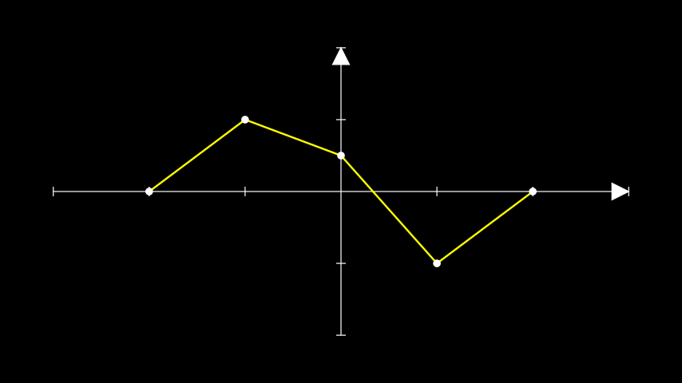

   Manim's plot_line_graph spelling and yellow default, with vertex dots.

.. code-block:: python

   from manim import Scene

   import manim_plots as mp

   class LineGraph(Scene):
       def construct(self):
           ax = mp.Axes(x_range=(-3, 3, 1), y_range=(-2, 2, 1))
           self.add(ax, ax.plot_line_graph([-2, -1, 0, 1, 2], [0, 1, 0.5, -1, 0]))

Animating a range
-----------------

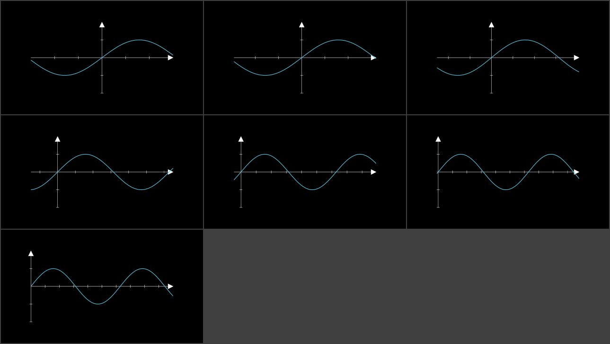

   The ticks, axis placement and sine update for every frame's range.

.. code-block:: python

   import numpy as np
   from manim import BLUE, Scene

   import manim_plots as mp

   class AnimatedRange(Scene):
       def construct(self):
           ax = mp.Axes(x_range=(-3, 3, 1), y_range=(-2, 2, 1), x_length=10, y_length=5)
           self.add(ax, ax.plot(np.sin, color=BLUE))
           self.play(ax.animate.set_x_range((0, 10)), run_time=1)

Creating axes and a curve
-------------------------

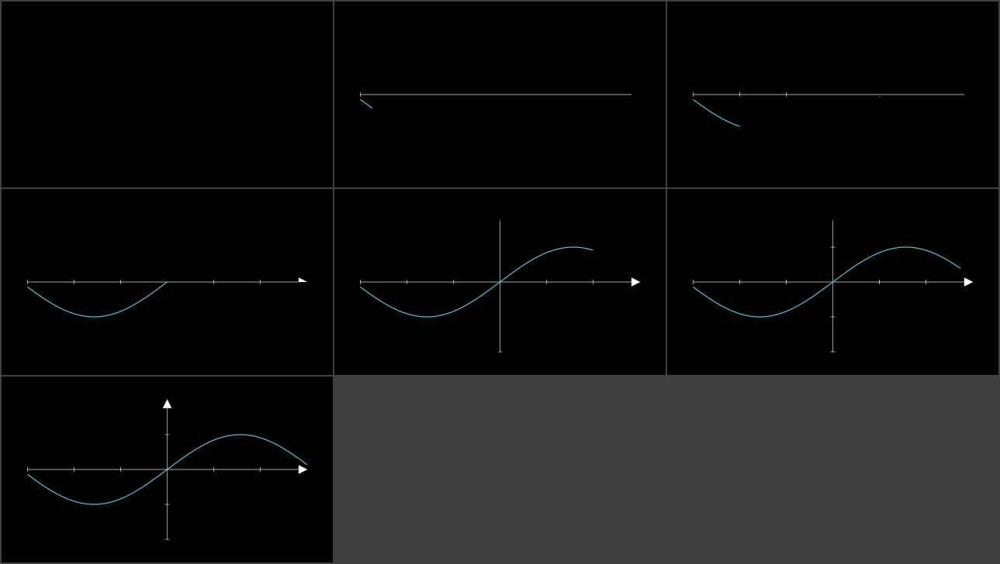

   Native Create draws the axes and curve together. The hidden frame takes its own lag
   slot on the axes.

.. code-block:: python

   import numpy as np
   from manim import BLUE, Create, Scene

   import manim_plots as mp

   class CreateAxesAndPlot(Scene):
       def construct(self):
           ax = mp.Axes(x_range=(-3, 3, 1), y_range=(-2, 2, 1))
           self.play(Create(ax), Create(ax.plot(np.sin, color=BLUE)), run_time=1)

The colour cycle and a legend
-----------------------------

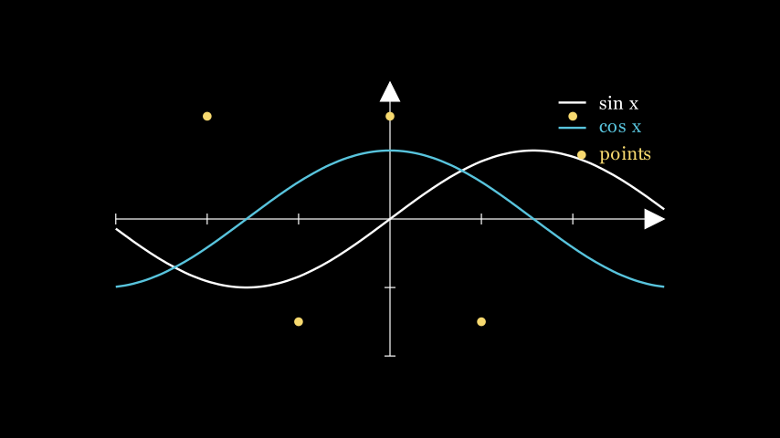

   Two curves and a scatter take white, blue and yellow. The legend uses their labels
   and styles.

.. code-block:: python

   import numpy as np
   from manim import Scene

   import manim_plots as mp

   class CycleAndLegend(Scene):
       def construct(self):
           ax = mp.Axes(x_range=(-3, 3, 1), y_range=(-2, 2, 1), x_length=10, y_length=5)
           sin = ax.plot(np.sin, label="sin x")
           cos = ax.plot(np.cos, label="cos x")
           dots = ax.scatter(
               [-2, -1, 0, 1, 2], [1.5, -1.5, 1.5, -1.5, 1.5], label="points"
           )
           self.add(ax, sin, cos, dots, ax.legend())

Line styles
-----------

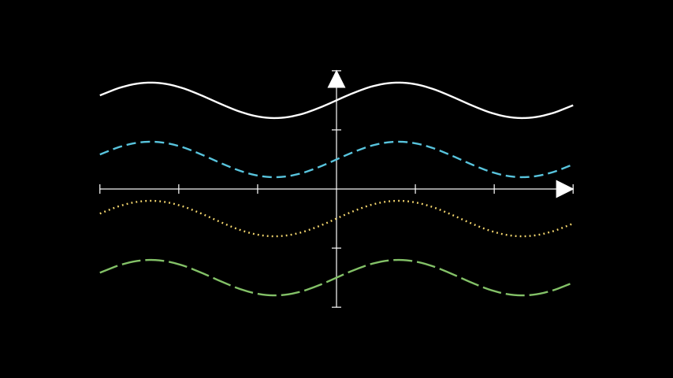

   Solid, dashed, dotted and a custom dash pattern, from top to bottom. Dash lengths are
   in scene units.

.. code-block:: python

   import numpy as np
   from manim import Scene

   import manim_plots as mp

   class LineStyles(Scene):
       def construct(self):
           ax = mp.Axes(x_range=(-3, 3, 1), y_range=(-2, 2, 1), x_length=10, y_length=5)
           self.add(ax)
           for k, style in enumerate(
               [mp.LineStyle.SOLID, mp.LineStyle.DASHED, mp.LineStyle.DOTTED]
           ):
               self.add(
                   ax.plot(lambda x, k=k: 1.5 - k + 0.3 * np.sin(2 * x), line_style=style)
               )
           self.add(ax.plot(lambda x: -1.5 + 0.3 * np.sin(2 * x), dash=(0.4, 0.1)))

Named markers
-------------

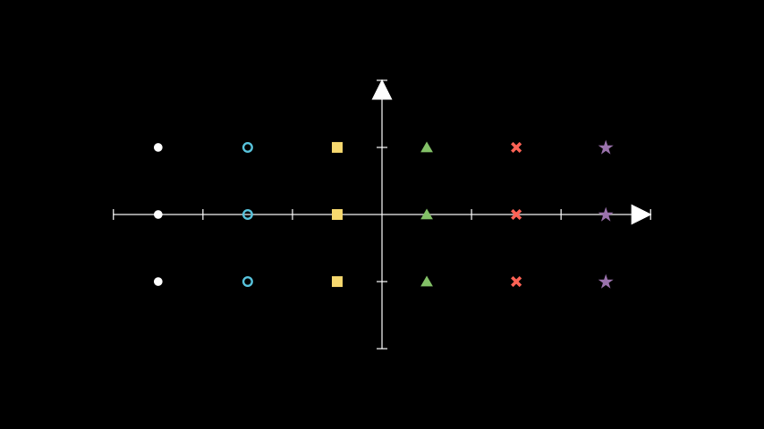

   Left to right: dot, circle, square, triangle, cross and star, with three points for
   each.

.. code-block:: python

   from manim import Scene

   import manim_plots as mp

   class NamedMarkers(Scene):
       def construct(self):
           ax = mp.Axes(x_range=(-3, 3, 1), y_range=(-2, 2, 1), x_length=10, y_length=5)
           self.add(ax)
           for k, marker in enumerate(mp.Marker):
               x = -2.5 + k
               self.add(ax.scatter([x, x, x], [1, 0, -1], marker=marker))

Tracing in data order
---------------------

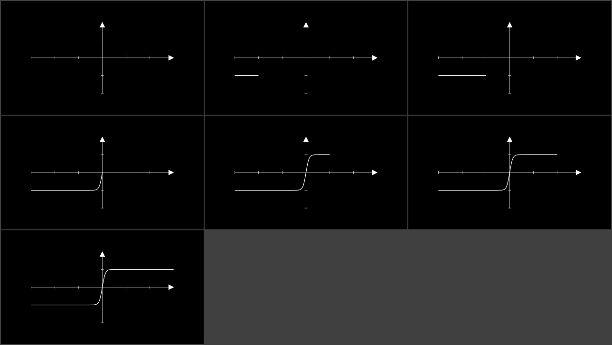

   With a linear rate function, TraceCurve advances steadily in x even near the densely
   sampled bend.

.. code-block:: python

   import numpy as np
   from manim import Scene, linear

   import manim_plots as mp

   class TraceCurveFrames(Scene):
       def construct(self):
           ax = mp.Axes(x_range=(-3, 3, 1), y_range=(-2, 2, 1), x_length=10, y_length=5)
           curve = ax.plot(lambda x: np.tanh(8 * x))
           self.add(ax)
           self.play(mp.TraceCurve(curve, rate_func=linear), run_time=1)

Morphing paths
--------------

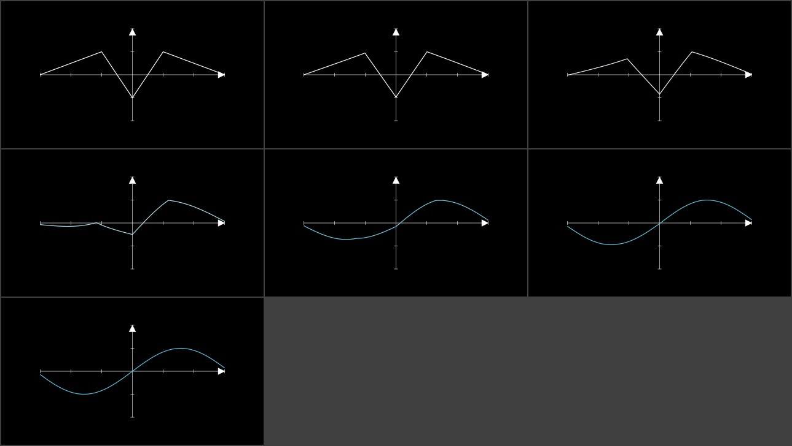

   Morph resamples a five-point zigzag and a fifty-point sine onto a shared arc-length
   lattice.

.. code-block:: python

   import numpy as np
   from manim import Scene

   import manim_plots as mp

   class MorphFrames(Scene):
       def construct(self):
           ax = mp.Axes(x_range=(-3, 3, 1), y_range=(-2, 2, 1), x_length=10, y_length=5)
           zigzag = ax.line([-3, -1, 0, 1, 3], [0, 1, -1, 1, 0])
           xs = np.linspace(-3, 3, 50)
           sine = ax.line(xs, np.sin(xs))
           self.add(ax, zigzag)
           self.play(mp.Morph(zigzag, sine), run_time=1)
